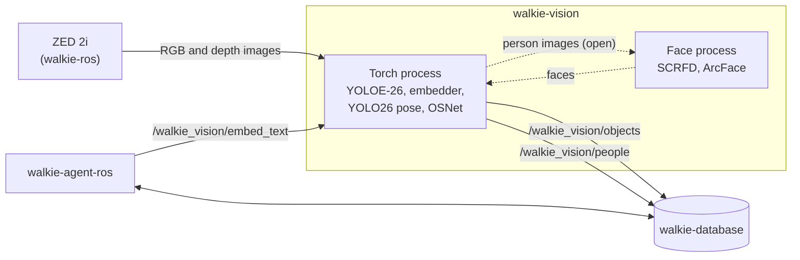

# Vision

This page explains how walkie-vision runs the robot's vision models, what
it publishes, and why it is built this way.

!!! note "Work in progress"
    The environment, the messages, the model interfaces and their tests
    exist. The ROS nodes do not yet: they come with the port of the model
    code from walkie-ai-server. The topic names below are the proposed ones.

## Summary

- walkie-vision runs the vision models of the old HTTP server,
  walkie-ai-server, and talks to the rest of the robot over ROS 2 only. It
  remembers nothing: walkie-database keeps the memory
  ([ADR-0002](decisions/0002-ros2-only-stateless.md)).
- Its messages are in `walkie_vision_msgs`, a package in this repository
  that holds only messages. walkie-database and walkie-agent-ros must build
  it too ([ADR-0003](decisions/0003-messages-in-this-repository.md)).
- All models share one Pixi environment, in two processes: one for the
  PyTorch models, one for the face models on ONNX Runtime
  ([ADR-0004](decisions/0004-one-environment-two-processes.md)).
- The environment uses CUDA 12 builds that run on the laptops' RTX 2060 and
  the robot's RTX 50-series GPU
  ([ADR-0005](decisions/0005-cuda-12-sm75-sm120.md)).
- The face models run on ONNX Runtime with vendored InsightFace code, not
  the `insightface` package
  ([ADR-0006](decisions/0006-face-models-without-insightface.md)).
- Every `pixi run` uses Zenoh, like the rest of the robot
  ([ADR-0007](decisions/0007-zenoh-in-every-pixi-environment.md)).
- The models are proposed, pending the embedding bake-off and a measurement
  on the robot ([ADR-0008](decisions/0008-model-choices.md)).

## Processes

| Process       | Models                                                                                     | Runtime                    |
| ------------- | ------------------------------------------------------------------------------------------ | -------------------------- |
| Torch process | YOLOE-26 segmentation with tracking, in text-prompt mode; the object and room embedder and the `EmbedText` service; YOLO26 pose; OSNet | PyTorch                    |
| Face process  | SCRFD face detection and ArcFace face embeddings, InsightFace's `buffalo_l`                 | ONNX Runtime on CUDA       |

The torch process is the only subscriber to the raw camera image: an HD2K
image in `bgra8` is about 11 MB, 15 times a second. The face process is
separate so that a crash in ONNX Runtime does not stop object detection.
How it gets its images, and how its faces reach `PersonDetection`, is still
open ([ADR-0004](decisions/0004-one-environment-two-processes.md)).

Speech-to-text and text-to-speech stay in walkie-agent-ros. GraspNet,
`yolo_node` and `obb3d` stay in walkie-ros.

## Topics and services

Published and served (proposed names):

| Name                        | Type                                      | What it is                                         |
| --------------------------- | ----------------------------------------- | -------------------------------------------------- |
| `/walkie_vision/objects`    | `walkie_vision_msgs/ObjectDetectionArray` | Every object in each processed image, also when there is none |
| `/walkie_vision/people`     | `walkie_vision_msgs/PersonDetectionArray` | Every person in each processed image, also when there is none |
| `/walkie_vision/embed_text` | `walkie_vision_msgs/srv/EmbedText`        | Text embeddings in the object embedder's space, for search |

Subscribed, from walkie-ros's ZED driver:

| Topic                                        | Type                       |
| -------------------------------------------- | -------------------------- |
| `/zed_head/zed_node/rgb/color/rect/image`    | `sensor_msgs/Image`, `bgra8`, 2208 x 1242 at 15 Hz |
| `/zed_head/zed_node/depth/depth_registered`  | `sensor_msgs/Image`, `32FC1` |
| `/zed_head/zed_node/depth/camera_info`       | `sensor_msgs/CameraInfo`   |

## Messages

Every field is commented in its file in
`ros2_ws/src/walkie_vision_msgs/`. [Add the Message Package](../setup/02-message-package.md)
explains the rules behind them.

### ObjectDetectionArray

| Field         | Type                     | What it is                                                         |
| ------------- | ------------------------ | ------------------------------------------------------------------ |
| `header`      | `std_msgs/Header`        | The stamp and camera frame of the image                            |
| `camera_info` | `sensor_msgs/CameraInfo` | The calibration of the image the boxes are in                      |
| `classes`     | `string[]`               | The text prompts the detector looked for. A class without a detection was not seen. |
| `detections`  | `ObjectDetection[]`      | The objects                                                        |

### ObjectDetection

| Field             | Type                          | What it is                                                              |
| ----------------- | ----------------------------- | ----------------------------------------------------------------------- |
| `label`           | `string`                      | One of the array's `classes`                                            |
| `score`           | `float32`                     | The detector's confidence, 0 to 1                                       |
| `track_id`        | `uint32`                      | The tracker's id, stable while the track lasts. 0 means not tracked.    |
| `bbox`            | `vision_msgs/BoundingBox2D`   | The box, in float pixels. `center.theta` is 0.                          |
| `embedding_model` | `string`                      | The `<model>` part of walkie-database's table name, for example `clip_vit_b16` |
| `embedding`       | `float32[]`                   | The unit-length embedding of the image inside `bbox`. Empty, with an empty model name, when none was computed. |
| `points`          | `sensor_msgs/PointCloud2`     | The object's points, cut out of the depth image with its mask, in `points.header.frame_id`. Empty without depth. |
| `crop`            | `sensor_msgs/CompressedImage` | The image inside `bbox`. Optional.                                      |

### PersonDetectionArray and PersonDetection

`PersonDetectionArray` has `header`, `camera_info` and `people`. One
`PersonDetection`:

| Field                   | Type                        | What it is                                                     |
| ----------------------- | --------------------------- | -------------------------------------------------------------- |
| `score`                 | `float32`                   | The person detector's confidence                               |
| `track_id`              | `uint32`                    | The tracker's id. 0 means not tracked.                         |
| `bbox`                  | `vision_msgs/BoundingBox2D` | The box around the whole person                                |
| `keypoints`             | `float32[34]`               | x and y of the 17 COCO keypoints, in COCO order                |
| `keypoint_scores`       | `float32[17]`               | The confidence of each keypoint                                |
| `face_bbox`             | `vision_msgs/BoundingBox2D` | The face, when one was found                                   |
| `face_det_score`        | `float32`                   | The face detector's confidence. 0 when there is no face.       |
| `face_model`            | `string`                    | For example `arcface_w600k_r50`. Empty when there is no face embedding. |
| `face_embedding`        | `float32[]`                 | The unit-length face embedding                                 |
| `appearance_model`      | `string`                    | For example `osnet_x1_0_msmt17`                                |
| `appearance_embedding`  | `float32[]`                 | The unit-length appearance embedding of the person's image     |

### EmbedText

| Part     | Field             | Type        | What it is                                                     |
| -------- | ----------------- | ----------- | -------------------------------------------------------------- |
| Request  | `texts`           | `string[]`  | The texts to embed. At least one.                              |
| Response | `success`         | `bool`      | False when nothing was embedded                                |
| Response | `message`         | `string`    | Why, when `success` is false                                   |
| Response | `embedding_model` | `string`    | The model, named as in `ObjectDetection.embedding_model`       |
| Response | `dim`             | `uint32`    | The length of each vector                                      |
| Response | `vectors`         | `float32[]` | One unit-length vector per text, one after another             |

walkie-database does not run models (walkie-database ADR-0006), so a text
search such as "a red mug" asks this service for the vector first, then
searches the table that `embedding_model` names.

## The model code

| Module                      | What it holds                                                                     |
| --------------------------- | --------------------------------------------------------------------------------- |
| `walkie_vision.providers`   | The interfaces every model implements (`ObjectDetector`, `Embedder`, `PoseEstimator`, `ReIdentifier`, `FaceRecognizer`), their result types, and the model names |
| `walkie_vision.fakes`       | A fake for each interface, with deterministic vectors, for tests without a GPU    |
| `walkie_vision.convert`     | Model results to messages, with the checks the message comments state             |
| `walkie_vision.face`        | SCRFD and ArcFace on ONNX Runtime (`FaceAnalyzer`, a `FaceRecognizer`)            |
| `walkie_vision.reid`        | OSNet x1.0 and its weights (`load_osnet`)                                         |
| `walkie_vision.models`      | Every model file and Hugging Face commit, with its checksum and licence           |

A node will hold one provider for each model, and use `convert` to publish
what they return. The tests run the same path with the fakes, so a node can
be tested without a GPU.

## The Restaurant constraint

The RoboCup@Home 2026 rulebook (revision 2025-12-01) says in the Restaurant
test (section 5.5) that the availability of wireless and of external
computing devices "can't be guaranteed. Assume unavailability." Section
3.4.1 adds that robots must be able to operate safely without external
computing.

So every model that a test depends on runs on the robot's own GPU. A cloud
model may only add to what the robot can already do on board.

## Open problems

- **The robot's GPU is not verified.** Its model, memory and driver are
  unknown, and the ONNX Runtime compile time on `sm_120` is not measured.
  See [On the robot](../setup/01-vision-environment.md#on-the-robot).
- **GPU memory.** All the models together need about 5.2 GiB on the
  laptop's 6 GB. The real total of both processes is not measured.
- **The face process interface.** How the face process gets images, and
  which process puts the faces into `PersonDetection`, is not decided.
- **Room vectors.** Which node embeds whole images for walkie-database's
  room table is not decided.
- **Captions.** Florence-2 runs, but there is no message or service for
  captions yet.
- **Depth and crops.** The code that cuts a `PointCloud2` out of the depth
  image with a mask, and that compresses a crop, belongs to the nodes and
  is not written. Which `camera_info` goes with the RGB image must be
  checked on the robot.
- **walkie-database.** Its object memory design (Proposed) has its own
  detection message and a `/walkie_database/detections` topic, without
  `bbox` or `track_id`. It must build `walkie_vision_msgs`, which needs
  `ros-jazzy-vision-msgs`, and subscribe to this repository's topics.
- **Vector table names.** `arcface_w600k_r50` and `osnet_x1_0_msmt17` follow
  walkie-database's migration 0002, which renames its face and appearance
  tables after their weights. That migration is not merged yet. A
  walkie-database without it still has `face_arcface` and
  `appearance_osnet`, which no `face_model` or `appearance_model` value
  matches.
- **Ultralytics' working directory.** YOLOE loads `mobileclip2_b.ts` by bare
  file name, so the torch process must run in `models/ultralytics/`.
- **Licences.** `buffalo_l` is non-commercial research only, Ultralytics is
  AGPL-3.0, and the CLIP mirror's model card disagrees with OpenAI's MIT
  licence. The repository itself has no licence yet, and `package.xml` says
  `TODO`.
- **Hugging Face models** are not in `pixi run fetch-models`. They download
  on first use, so the robot must be online once.
- **No test workflow.** GitHub Actions builds only the docs. A test workflow
  would install the 9.6 GB default environment on every run.
- **No linter or formatter** is set up.
- **Two copies of `libcudart`.** The torchvision wheel bundles its own CUDA
  runtime (`torchvision.libs/libcudart.e8e8b82a.so.12`), next to the
  `nvidia-cuda-runtime-cu12` wheel's copy, and a process loads both. This
  is normal for torchvision wheels and has caused no problem so far.
- **Zenoh warnings.** Every node prints deprecated-setting warnings from
  rmw_zenoh's built-in configuration.
- **Not on GitHub.** The clone URL and the site URL are placeholders until
  the repository is published.

## Decisions

??? success "ADR-0001: Record architecture decisions · Accepted"

    --8<-- "architecture/decisions/0001-record-architecture-decisions.md:body"

??? success "ADR-0002: Serve the models over ROS 2 only, statelessly · Accepted"

    --8<-- "architecture/decisions/0002-ros2-only-stateless.md:body"

??? success "ADR-0003: Keep the messages in a msg-only package in this repository · Accepted"

    --8<-- "architecture/decisions/0003-messages-in-this-repository.md:body"

??? success "ADR-0004: Run the models in one Pixi environment and two processes · Accepted"

    --8<-- "architecture/decisions/0004-one-environment-two-processes.md:body"

??? success "ADR-0005: Use CUDA 12 builds that cover sm_75 and sm_120 · Accepted"

    --8<-- "architecture/decisions/0005-cuda-12-sm75-sm120.md:body"

??? success "ADR-0006: Run the face models on onnxruntime without the insightface package · Accepted"

    --8<-- "architecture/decisions/0006-face-models-without-insightface.md:body"

??? success "ADR-0007: Use rmw_zenoh_cpp in every Pixi environment · Accepted"

    --8<-- "architecture/decisions/0007-zenoh-in-every-pixi-environment.md:body"

??? note "ADR-0008: Model choices · Proposed"

    --8<-- "architecture/decisions/0008-model-choices.md:body"
