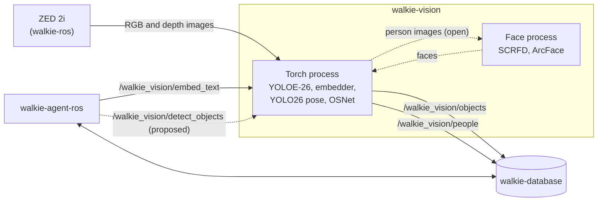
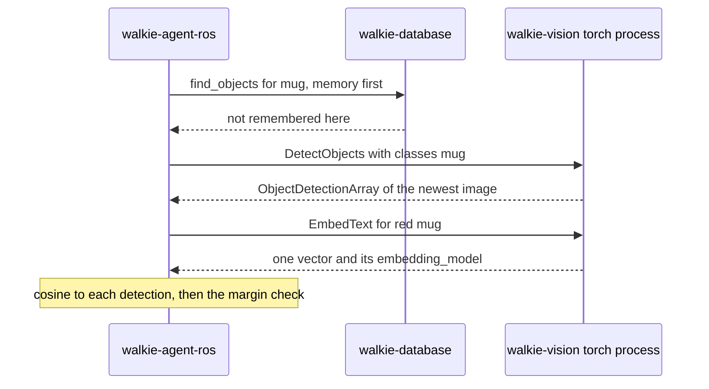

# Vision

This page explains how walkie-vision runs the robot's vision models, what
it publishes, and why it is built this way.

!!! note "Work in progress"
    The environment, the messages, the model interfaces and their tests
    exist. The ROS nodes do not yet: they come with the port of the model
    code from walkie-ai-server. The topic names below are the proposed ones.

## Summary

- walkie-vision runs the vision models of the old HTTP server,
  walkie-ai-server, and talks to the rest of the robot over ROS 2 only. It
  remembers nothing: walkie-database keeps the memory
  ([ADR-0002](decisions/0002-ros2-only-stateless.md)).
- Its messages are in `walkie_vision_msgs`, a package in this repository
  that holds only messages. walkie-database and walkie-agent-ros must build
  it too ([ADR-0003](decisions/0003-messages-in-this-repository.md)).
- All models share one Pixi environment, in two processes: one for the
  PyTorch models, one for the face models on ONNX Runtime
  ([ADR-0004](decisions/0004-one-environment-two-processes.md)).
- The environment uses CUDA 12 builds that run on the laptops' RTX 2060 and
  the robot's RTX 50-series GPU
  ([ADR-0005](decisions/0005-cuda-12-sm75-sm120.md)).
- The face models run on ONNX Runtime with vendored InsightFace code, not
  the `insightface` package
  ([ADR-0006](decisions/0006-face-models-without-insightface.md)).
- Every `pixi run` uses Zenoh, like the rest of the robot
  ([ADR-0007](decisions/0007-zenoh-in-every-pixi-environment.md)).
- The models are proposed, pending the embedding bake-off and a measurement
  on the robot ([ADR-0008](decisions/0008-model-choices.md)).
- A new `DetectObjects` service would detect named objects in the newest
  image on request, for walkie-agent-ros's proposed self-evolving agent,
  without touching the streaming detector
  ([ADR-0009](decisions/0009-on-demand-detect-objects.md), and
  [the proposed section](#proposed-on-demand-detectobjects-for-the-self-evolving-agent)).

## Processes

| Process       | Models                                                                                     | Runtime                    |
| ------------- | ------------------------------------------------------------------------------------------ | -------------------------- |
| Torch process | YOLOE-26 segmentation with tracking, in text-prompt mode; the object and room embedder and the `EmbedText` service; YOLO26 pose; OSNet | PyTorch                    |
| Face process  | SCRFD face detection and ArcFace face embeddings, InsightFace's `buffalo_l`                 | ONNX Runtime on CUDA       |

The torch process is the only subscriber to the raw camera image: an HD2K
image in `bgra8` is about 11 MB, 15 times a second. The face process is
separate so that a crash in ONNX Runtime does not stop object detection.
How it gets its images, and how its faces reach `PersonDetection`, is still
open ([ADR-0004](decisions/0004-one-environment-two-processes.md)).

Speech-to-text and text-to-speech stay in walkie-agent-ros. GraspNet,
`yolo_node` and `obb3d` stay in walkie-ros.

## Topics and services

Published and served (proposed names):

| Name                        | Type                                      | What it is                                         |
| --------------------------- | ----------------------------------------- | -------------------------------------------------- |
| `/walkie_vision/objects`    | `walkie_vision_msgs/ObjectDetectionArray` | Every object in each processed image, also when there is none |
| `/walkie_vision/people`     | `walkie_vision_msgs/PersonDetectionArray` | Every person in each processed image, also when there is none |
| `/walkie_vision/embed_text` | `walkie_vision_msgs/srv/EmbedText`        | Text embeddings in the object embedder's space, for search |
| `/walkie_vision/detect_objects` | `walkie_vision_msgs/srv/DetectObjects` | Proposed, not built ([ADR-0009](decisions/0009-on-demand-detect-objects.md)). Named objects in the newest image, on request |

Subscribed, from walkie-ros's ZED driver:

| Topic                                        | Type                       |
| -------------------------------------------- | -------------------------- |
| `/zed_head/zed_node/rgb/color/rect/image`    | `sensor_msgs/Image`, `bgra8`, 2208 x 1242 at 15 Hz |
| `/zed_head/zed_node/depth/depth_registered`  | `sensor_msgs/Image`, `32FC1` |
| `/zed_head/zed_node/depth/camera_info`       | `sensor_msgs/CameraInfo`   |

## Messages

Every field is commented in its file in
`ros2_ws/src/walkie_vision_msgs/`. [Add the Message Package](../setup/02-message-package.md)
explains the rules behind them.

### ObjectDetectionArray

| Field         | Type                     | What it is                                                         |
| ------------- | ------------------------ | ------------------------------------------------------------------ |
| `header`      | `std_msgs/Header`        | The stamp and camera frame of the image                            |
| `camera_info` | `sensor_msgs/CameraInfo` | The calibration of the image the boxes are in                      |
| `classes`     | `string[]`               | The text prompts the detector looked for. A class without a detection was not seen. |
| `detections`  | `ObjectDetection[]`      | The objects                                                        |

### ObjectDetection

| Field             | Type                          | What it is                                                              |
| ----------------- | ----------------------------- | ----------------------------------------------------------------------- |
| `label`           | `string`                      | One of the array's `classes`                                            |
| `score`           | `float32`                     | The detector's confidence, 0 to 1                                       |
| `track_id`        | `uint32`                      | The tracker's id, stable while the track lasts. 0 means not tracked.    |
| `bbox`            | `vision_msgs/BoundingBox2D`   | The box, in float pixels. `center.theta` is 0.                          |
| `embedding_model` | `string`                      | The `<model>` part of walkie-database's table name, for example `clip_vit_b16` |
| `embedding`       | `float32[]`                   | The unit-length embedding of the image inside `bbox`. Empty, with an empty model name, when none was computed. |
| `points`          | `sensor_msgs/PointCloud2`     | The object's points, cut out of the depth image with its mask, in `points.header.frame_id`. Empty without depth. |
| `crop`            | `sensor_msgs/CompressedImage` | The image inside `bbox`. Optional.                                      |

### PersonDetectionArray and PersonDetection

`PersonDetectionArray` has `header`, `camera_info` and `people`. One
`PersonDetection`:

| Field                   | Type                        | What it is                                                     |
| ----------------------- | --------------------------- | -------------------------------------------------------------- |
| `score`                 | `float32`                   | The person detector's confidence                               |
| `track_id`              | `uint32`                    | The tracker's id. 0 means not tracked.                         |
| `bbox`                  | `vision_msgs/BoundingBox2D` | The box around the whole person                                |
| `keypoints`             | `float32[34]`               | x and y of the 17 COCO keypoints, in COCO order                |
| `keypoint_scores`       | `float32[17]`               | The confidence of each keypoint                                |
| `face_bbox`             | `vision_msgs/BoundingBox2D` | The face, when one was found                                   |
| `face_det_score`        | `float32`                   | The face detector's confidence. 0 when there is no face.       |
| `face_model`            | `string`                    | For example `arcface_w600k_r50`. Empty when there is no face embedding. |
| `face_embedding`        | `float32[]`                 | The unit-length face embedding                                 |
| `appearance_model`      | `string`                    | For example `osnet_x1_0_msmt17`                                |
| `appearance_embedding`  | `float32[]`                 | The unit-length appearance embedding of the person's image     |

### EmbedText

| Part     | Field             | Type        | What it is                                                     |
| -------- | ----------------- | ----------- | -------------------------------------------------------------- |
| Request  | `texts`           | `string[]`  | The texts to embed. At least one.                              |
| Response | `success`         | `bool`      | False when nothing was embedded                                |
| Response | `message`         | `string`    | Why, when `success` is false                                   |
| Response | `embedding_model` | `string`    | The model, named as in `ObjectDetection.embedding_model`       |
| Response | `dim`             | `uint32`    | The length of each vector                                      |
| Response | `vectors`         | `float32[]` | One unit-length vector per text, one after another             |

walkie-database does not run models (walkie-database ADR-0006), so a text
search such as "a red mug" asks this service for the vector first, then
searches the table that `embedding_model` names.

## The model code

| Module                      | What it holds                                                                     |
| --------------------------- | --------------------------------------------------------------------------------- |
| `walkie_vision.providers`   | The interfaces every model implements (`ObjectDetector`, `Embedder`, `PoseEstimator`, `ReIdentifier`, `FaceRecognizer`), their result types, and the model names |
| `walkie_vision.fakes`       | A fake for each interface, with deterministic vectors, for tests without a GPU    |
| `walkie_vision.convert`     | Model results to messages, with the checks the message comments state             |
| `walkie_vision.face`        | SCRFD and ArcFace on ONNX Runtime (`FaceAnalyzer`, a `FaceRecognizer`)            |
| `walkie_vision.reid`        | OSNet x1.0 and its weights (`load_osnet`)                                         |
| `walkie_vision.models`      | Every model file and Hugging Face commit, with its checksum and licence           |

A node will hold one provider for each model, and use `convert` to publish
what they return. The tests run the same path with the fakes, so a node can
be tested without a GPU.

## The Restaurant constraint

The RoboCup@Home 2026 rulebook (revision 2025-12-01) says in the Restaurant
test (section 5.5) that the availability of wireless and of external
computing devices "can't be guaranteed. Assume unavailability." Section
3.4.1 adds that robots must be able to operate safely without external
computing.

So every model that a test depends on runs on the robot's own GPU. A cloud
model may only add to what the robot can already do on board.

## Proposed: on-demand DetectObjects for the self-evolving agent

!!! note "Status: Proposed"
    Nothing in this section is built or accepted. It records what
    walkie-agent-ros's proposed self-evolving agent asks of this
    repository, and the proposed
    [ADR-0009](decisions/0009-on-demand-detect-objects.md).

walkie-agent-ros plans to turn its agent into a self-evolving agent
(walkie-agent-ros `docs/architecture/self-evolving-agent.md`, Proposed).
The agent gets small typed tools, called atomics, which it chains into
bundles. It also writes new tools of its own. In simulation these are
drafts, which a human reviews before they are kept. At competitions, when
the run profile allows it and the robot is online, it may write tools for
the current session that only read, perceive and speak.

Generated tools run at one of three access levels (walkie-agent-ros
`docs/architecture/access-levels.md`, Proposed). Unrestricted and Standard
run only in simulation. Competition, the default, is the only level
allowed on the real robot.

Two of the agent's perception atomics call walkie-vision:

- `detect_objects` asks a new `DetectObjects` service to detect named
  objects in the newest image.
- `search_detections` asks the existing `EmbedText` service for the vector
  of a description such as "red mug", and ranks the detections with it.

Both atomics are planned. Both are also in the small set that generated
tools may call at Competition level, so generated code on the robot can
reach these services, but only through the atomics. The work in this
repository is listed in
[What changes in this repository](#what-changes-in-this-repository).

### How the agent finds an object

The agent looks in memory first, then looks with the camera, then narrows
the result down. Every step runs on the robot. The full cascade is on
walkie-agent-ros's page (`docs/architecture/self-evolving-agent.md`,
"Finding objects with search_detections"). The part that involves
walkie-vision:

| Agent tool          | What walkie-vision does                                                          |
| ------------------- | -------------------------------------------------------------------------------- |
| `detect_objects`    | `DetectObjects` detects the nouns with YOLOE in the newest image. It returns boxes, embeddings, points and crops. |
| `search_detections` | `EmbedText` embeds the description and the noun as one text. The agent computes the cosine and the margin. |
| `localize_object`   | Nothing at run time. It reads the detection's `points` and the array's `header`. |

The other steps need no walkie-vision service. `find_objects` asks
walkie-database's memory, `relate_objects` computes relations from
positions in `base_footprint`, and `wait_for_person` asks the person. Of
these six tools, only `find_objects` exists today. The other five are
planned.

The agent's tool calls already separate the noun ("mug") from the
attributes ("red"), and a separate tool takes the relation ("the left
one"). Only the noun goes to the detector. Only the attributes and the noun
go to `EmbedText`. Relations such as leftmost, nearest or `left_of` are
computed from positions, because CLIP-family models are near chance on
spatial words. `search_detections` ends in one of three ways: one match,
up to 3 candidates that the agent resolves with `relate_objects` or a
question, or nothing found with the labels it saw.

The 3D position of a found object is worked out robot-side, with TF looked
up at the image's stamp: by walkie-ros perception now, and later by
walkie-database once it ingests detections. Which walkie-ros interface
serves it is not settled. walkie-ros has no point-cloud-to-map service
today: its `cloud_to_map` node republishes the whole ZED cloud in `map`,
and `/get_3d_poses` samples its own newest depth image rather than a
detection's points.

### detect_objects and DetectObjects

`detect_objects` passes one or more nouns. A bundle can add a second noun,
for example the anchor of "the cup left of the plate". The proposed
service is below, at sketch level. The exact `.srv` is left to the
implementation ([ADR-0009](decisions/0009-on-demand-detect-objects.md)).

| Part     | Field     | Type                   | What it is                                                     |
| -------- | --------- | ---------------------- | -------------------------------------------------------------- |
| Request  | `classes` | `string[]`             | The nouns to look for, for example `mug`. At least one.        |
| Response | `success` | `bool`                 | False when the request could not be served                     |
| Response | `message` | `string`               | Why, when `success` is false                                   |
| Response | `objects` | `ObjectDetectionArray` | The detections in the newest image. Its `classes` are the request's nouns. |

How it would run:

- **On the newest image.** The planned torch process will be the only
  subscriber to the camera, and will hold only the newest RGB image, depth
  image and `camera_info`. The service reads those and adds no subscriber.
  It keeps no image and no detection after it answers. Only the on-demand
  model's last class list stays loaded, as a cache. It returns no id for
  the image.
- **With everything the topic carries.** Every detection has its box, its
  embedding from the object embedder, its points and, when the topic sends
  one, its crop, as on `/walkie_vision/objects`. The array's `header` is
  the image's stamp and frame, not the time of the answer.
- **On its own YOLOE instance, without a tracker.** The streaming detector
  keeps its classes and its tracks. On-demand detections have `track_id` 0.
- **To the caller only.** The result is not published on
  `/walkie_vision/objects`.

**No frame handles.** A `capture_frame` tool that returns an RGBD image
was considered for the agent, and folded into `detect_objects`. A
robot-side frame kept for later calls would make walkie-vision stateful,
which [ADR-0002](decisions/0002-ros2-only-stateless.md) rules out. Keeping
the raw frame in the agent instead conflicts with walkie-agent-ros
ADR-0028 (Proposed), which keeps raw camera images out of the agent and
allows only one compressed snapshot on request. An HD2K frame is about
11 MB, and it must not reach the LLM.

**Why not re-prompt the streaming detector.** The obvious way to detect a
new noun is to add it to the streaming detector's text prompts. It costs
too much:

| Cost                         | Why                                                                               |
| ---------------------------- | --------------------------------------------------------------------------------- |
| About 1.5 s per new list     | `set_classes()` with 5 names took 1.5 s on the RTX 2060 ([Measured on the RTX 2060](../setup/01-vision-environment.md#measured-on-the-rtx-2060)). In the installed Ultralytics 8.4.182, it loads the text encoder again on every call that changes the list. |
| Track ids may reset          | `ObjectDetector` in `walkie_vision.providers` allows it. In Ultralytics 8.4.182, `set_classes()` drops the predictor, and the trackers live on the predictor (read in the code, not tested). |
| The `classes` field changes  | A class in `classes` without a detection was not seen (`ObjectDetectionArray.msg`). While the caller's nouns replace the task's list, walkie-database would read every task class as "not seen" when it was only "not looked for". |
| Restoring the list costs again | Setting the old list back pays the 1.5 s again and resets the tracks again. Two callers at once would fight over one list. |

A second instance avoids the last three. It still pays the 1.5 s for each
new list, but on the caller's request instead of stalling the streaming
detector. It also costs GPU memory, which is not measured yet. A request
with the same list as the one before skips the text encoder, so repeated
searches for the same noun stay fast.

**What the agent does with the answer.** walkie-agent-ros keeps the
response in its own handle store, under an id such as `det_3f2a`, with the
image's stamp and frame and the robot's pose when the image was taken. Its
LLM sees only labels, scores and handle ids. A handle goes stale when the
base has moved more than 5 cm or 3° since the image, with a soft limit of
10 minutes. That is why the `header` stamp must be the image's own.

### search_detections and EmbedText

`EmbedText` is already designed ([EmbedText](#embedtext)).
`search_detections` sends the description and the noun as one text, such
as "red mug", and computes the cosine between that vector and each
detection's embedding.

- **One model.** The vectors are comparable only when `EmbedText`'s
  `embedding_model` equals the detections' `embedding_model`. The agent
  must check that, and never rank across two models. The model names in the
  messages exist for exactly this.
- **A minimum score and a margin.** Below a minimum score the answer is
  `NOT_FOUND`, with the labels seen. Above it, the best match must lead the
  second best by at least 0.05, or the answer is `AMBIGUOUS`, with up to 3
  candidates. Both values are to be tuned on the bake-off data.
- **Tuned per model.** The bake-off guide warns that margins compare only
  within one model ([Embedding bake-off](../guides/bakeoff.md)). The
  object embedder is still open: SigLIP 2 is proposed, EmbeddingGemma 2 is
  the challenger, and CLIP ViT-B/16 stays the baseline until the bake-off
  decides ([ADR-0008](decisions/0008-model-choices.md)). When it changes,
  the agent's minimum score and margin must be tuned again.
- **A deadline.** In the agent's design sketch, `search_detections` has a
  3 s timeout, and its example traces show `EmbedText` timing out after
  2 s. Both are example values, not settled. `EmbedText` must answer well
  inside them.

**Not for tool search.** The agent also searches its own catalogue of
tools, with a hybrid keyword and vector index (walkie-agent-ros ADR-0046,
Proposed). It deliberately does not use `EmbedText` for the vectors. The
object embedder is an image-text model with a short text context and no
task prompt, and tool search would then depend on the vision service. The
agent runs its own small text-embedding model on the CPU instead: the
proposed candidate is `qwen3-embedding:0.6b`. So `EmbedText` serves object
search only, and a new object embedder never touches the tool index.

### In simulation

The walkie-vision nodes do not exist yet. walkie-agent-ros's sim harvest
runs its agent in MuJoCo (walkie-agent-ros `docs/architecture/harvest.md`,
Proposed). There, a planned `oracle_perception` node in walkie-agent-ros
publishes detections from the scenario's spec, with configurable noise and
dropout, in `walkie_vision_msgs` types. People come only from that node,
because the sim world has no person bodies. Whether that node, or
something else, also answers `DetectObjects` and `EmbedText` in sim is not
decided (open question 7).

walkie-agent-ros's planned unit-test mocks will use the same `hash_vector`
as `walkie_vision.fakes`, so their ranking is deterministic. A scene file
drives a mock detector and a mock text embedder. `hash_vector` then becomes
something another repository relies on. A change to how it derives vectors
must be matched in walkie-agent-ros, or the rankings in its tests change
without an error.

Hash vectors match only on equal input. `hash_vector` gives equal vectors
for equal bytes and nearly orthogonal vectors otherwise, and
`FakeEmbedder` prefixes texts with `b"text "` and images with
`b"image "`. So a `FakeEmbedder` text vector never matches a
`FakeEmbedder` image vector. If the sim detections carried image vectors,
a minimum-score check would always answer `NOT_FOUND`. For a sim search to
find anything, the detection embeddings must be hashed from the same key
as the query text.

Later, a smaller share of harvest runs is planned to use the real
walkie-vision detectors on rendered MuJoCo frames, once the nodes exist.

### What walkie-agent-ros builds against

- **The message package.** walkie-agent-ros will pin `walkie_vision_msgs`
  in its `ros2_ws.repos` and add it to the `--packages-select` allow-list
  of its `build-ros2` task, as it does for `walkie_database_msgs` today.
  That waits until this repository is on GitHub (walkie-agent-ros
  ADR-0034).
- **The real clients.** `DetectObjects` and `EmbedText` clients are a
  parallel track, from phase 2 of the agent's roadmap, and the agent's
  bundle tests are rerun against them. Until then its presets stay backed
  by mocks, and a real run refuses to start with a mock backend.
- **The fields.** The agent's mocks and `oracle_perception` copy the
  `walkie_vision_msgs` fields. So a field change here also needs a matching
  change there, not only a rebuild of the package. The bundle tests rerun
  against the real clients catch drift.
- **Field names.** When a generated tool reads a ROS message, the agent's
  bridge finds any nested `Image`, `CompressedImage` or `PointCloud2`
  field, and any `float32[]` field whose name ends in `embedding`. At
  Standard level it drops them. At Unrestricted level it turns them into
  handles. At Competition level, generated tools get no raw ROS at all, and
  perception atomics return labels, counts and enums only: no OCR and no
  captions. So a new vector field in `walkie_vision_msgs` must end in
  `embedding`, and images and point clouds must use the `sensor_msgs`
  types, or the bridge misses them.
- **An exception today.** `EmbedText`'s `vectors` field does not follow
  that rule. Standard cannot call `EmbedText`: its read-only service list
  does not include it. At Unrestricted, any service off the never-list may
  be called, so the vectors would pass through unless the bridge names the
  field (open question 8).
- **The GPU.** The agent keeps its tool-search embedder on the CPU, to
  leave the GPU for vision and its local fallback LLM. That LLM is planned
  at 7 to 14B parameters, about 9 GB at q4 for a 14B model (estimated), on
  the same GPU as walkie-vision.

### What changes in this repository

| Piece                                                    | Location                                                    | Status |
| -------------------------------------------------------- | ----------------------------------------------------------- | ------ |
| The `DetectObjects` service type                         | `ros2_ws/src/walkie_vision_msgs/srv/DetectObjects.srv`      | New    |
| Its entry in `rosidl_generate_interfaces`                | `ros2_ws/src/walkie_vision_msgs/CMakeLists.txt`             | Changed |
| Field pins for its request and response                  | `test_message_fields` in `tests/test_convert.py`            | Changed |
| Filling the response                                     | `walkie_vision.convert`. `to_object_detection_array` fills `objects`. The `success` and `message` handling is new, like `fill_embed_text_response` for `EmbedText`. | New |
| The `DetectObjects` server, with its own YOLOE instance and no tracker | The torch-process node                        | New, with the node |
| The `EmbedText` server                                   | The torch-process node                                      | Already designed. Built with the node, with no change to its type. |
| `hash_vector`                                            | `walkie_vision.fakes`                                       | Unchanged. walkie-agent-ros's mocks will rely on it. |
| Publishing the repository on GitHub                      | None                                                        | Needed before walkie-agent-ros can pin the package. See "Not on GitHub" in [Open problems](#open-problems). |

### Open questions

1. **GPU memory and latency of the second YOLOE instance.** Neither is
   measured. An alternative to a second instance, unverified: run the
   streaming model's weights with per-call prompt embeddings
   (`YOLOEModel.predict(tpe=...)` in Ultralytics 8.4.182). That would share
   GPU memory, but it bypasses the high-level predictor, so its class names
   and post-processing would not follow. Blocks: accepting ADR-0009, and
   the s or m model size in ADR-0008.
2. **The cost of a new class list.** Ultralytics can keep the text encoder
   loaded (`cache_clip_model` in `YOLOEModel.get_text_pe`), and
   `YOLOE.set_classes()` accepts embeddings computed beforehand. How the
   1.5 s splits between loading and encoding is not measured, so neither
   saving is known. Blocks: the agent's timeout for `detect_objects`.
3. **How old the newest image may be.** No age limit is set, and it is not
   decided whether the service waits for an image taken after the base
   stopped. Blocks: the service's failure reasons, and the agent's
   staleness rule.
4. **Whether on-demand results reach walkie-database.** They answer only
   the caller. Publishing them on `/walkie_vision/objects` would mix two
   class lists in one topic. Another topic would need a walkie-database
   change. walkie-agent-ros plans to move `localize_object` to
   walkie-database once it ingests detections, which makes this question
   matter later. Blocks: nothing yet.
5. **The model name of sim embeddings.** This repository's fakes name
   their models `fake_...`, so their vectors can never be stored in a real
   table. `oracle_perception` should do the same. Blocks: nothing here. It
   matters once sim detections reach walkie-database.
6. **An annotated image for a vision-language model.** When the network is
   up, the agent may show one annotated image, with numbered boxes, to a
   vision-language model to settle an ambiguous match. A stateless
   robot-side service would return it (walkie-agent-ros ADR-0028). Which
   service is not decided. Under walkie-agent-ros ADR-0034, a new vision
   ability starts in walkie-vision. At Competition level the model's
   answer must be an enum, such as which numbered box, never caption text,
   and text regions in the image are masked first, so that a sign held up
   to the camera cannot instruct the robot. Blocks: only that online
   fallback, which is never on the critical path.
7. **What stands in for `DetectObjects` and `EmbedText` in sim.** It is not
   decided whether `oracle_perception` answers them, and how it derives
   detection embeddings so that `search_detections` can return a match:
   for example, `hash_vector` of the spec's description and label, with
   the same key that the sim text embedder hashes. That is for
   walkie-agent-ros to decide, within the constraint in
   [In simulation](#in-simulation). Blocks: `search_detections` in harvest
   runs.
8. **`EmbedText`'s `vectors` and the bridge.** The field does not end in
   `embedding`, so the bridge's rule misses it. Either the bridge names it
   explicitly, or the field is renamed, which is a message change in every
   repository that builds the package. Blocks: nothing on the robot. It
   matters only at Unrestricted, which runs only in sim.
9. **A rate limit for generated callers.** At Competition, generated tools
   may call `detect_objects`, within the agent's budget of 10 tool calls
   and 15 s per invocation. Each new class list costs about 1.5 s on the
   on-demand instance. Whether `DetectObjects` needs a limit of its own is
   not decided. Blocks: nothing until the service is built.

## Open problems

- **The robot's GPU is not verified.** Its model, memory and driver are
  unknown, and the ONNX Runtime compile time on `sm_120` is not measured.
  See [On the robot](../setup/01-vision-environment.md#on-the-robot).
- **GPU memory.** All the models together need about 5.2 GiB on the
  laptop's 6 GB. The real total of both processes is not measured.
- **The face process interface.** How the face process gets images, and
  which process puts the faces into `PersonDetection`, is not decided.
- **Room vectors.** Which node embeds whole images for walkie-database's
  room table is not decided.
- **Captions.** Florence-2 runs, but there is no message or service for
  captions yet.
- **Depth and crops.** The code that cuts a `PointCloud2` out of the depth
  image with a mask, and that compresses a crop, belongs to the nodes and
  is not written. Which `camera_info` goes with the RGB image must be
  checked on the robot.
- **walkie-database.** Its object memory design (Proposed) has its own
  detection message and a `/walkie_database/detections` topic, without
  `bbox` or `track_id`. It must build `walkie_vision_msgs`, which needs
  `ros-jazzy-vision-msgs`, and subscribe to this repository's topics.
- **Vector table names.** `arcface_w600k_r50` and `osnet_x1_0_msmt17` follow
  walkie-database's migration 0002, which renames its face and appearance
  tables after their weights. That migration is not merged yet. A
  walkie-database without it still has `face_arcface` and
  `appearance_osnet`, which no `face_model` or `appearance_model` value
  matches.
- **Ultralytics' working directory.** YOLOE loads `mobileclip2_b.ts` by bare
  file name, so the torch process must run in `models/ultralytics/`.
- **Licences.** `buffalo_l` is non-commercial research only, Ultralytics is
  AGPL-3.0, and the CLIP mirror's model card disagrees with OpenAI's MIT
  licence. The repository itself has no licence yet, and `package.xml` says
  `TODO`.
- **Hugging Face models** are not in `pixi run fetch-models`. They download
  on first use, so the robot must be online once.
- **No test workflow.** GitHub Actions builds only the docs. A test workflow
  would install the 9.6 GB default environment on every run.
- **No linter or formatter** is set up.
- **Two copies of `libcudart`.** The torchvision wheel bundles its own CUDA
  runtime (`torchvision.libs/libcudart.e8e8b82a.so.12`), next to the
  `nvidia-cuda-runtime-cu12` wheel's copy, and a process loads both. This
  is normal for torchvision wheels and has caused no problem so far.
- **Zenoh warnings.** Every node prints deprecated-setting warnings from
  rmw_zenoh's built-in configuration.
- **Not on GitHub.** The clone URL and the site URL are placeholders until
  the repository is published.

## Decisions

??? success "ADR-0001: Record architecture decisions · Accepted"

    --8<-- "architecture/decisions/0001-record-architecture-decisions.md:body"

??? success "ADR-0002: Serve the models over ROS 2 only, statelessly · Accepted"

    --8<-- "architecture/decisions/0002-ros2-only-stateless.md:body"

??? success "ADR-0003: Keep the messages in a msg-only package in this repository · Accepted"

    --8<-- "architecture/decisions/0003-messages-in-this-repository.md:body"

??? success "ADR-0004: Run the models in one Pixi environment and two processes · Accepted"

    --8<-- "architecture/decisions/0004-one-environment-two-processes.md:body"

??? success "ADR-0005: Use CUDA 12 builds that cover sm_75 and sm_120 · Accepted"

    --8<-- "architecture/decisions/0005-cuda-12-sm75-sm120.md:body"

??? success "ADR-0006: Run the face models on onnxruntime without the insightface package · Accepted"

    --8<-- "architecture/decisions/0006-face-models-without-insightface.md:body"

??? success "ADR-0007: Use rmw_zenoh_cpp in every Pixi environment · Accepted"

    --8<-- "architecture/decisions/0007-zenoh-in-every-pixi-environment.md:body"

??? note "ADR-0008: Model choices · Proposed"

    --8<-- "architecture/decisions/0008-model-choices.md:body"

??? note "ADR-0009: Add an on-demand DetectObjects service for detecting by name · Proposed"

    --8<-- "architecture/decisions/0009-on-demand-detect-objects.md:body"
