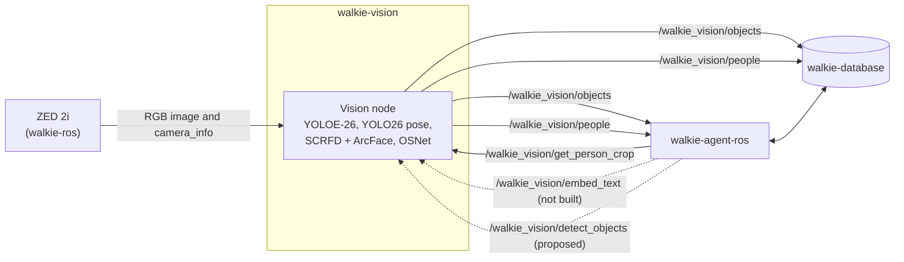
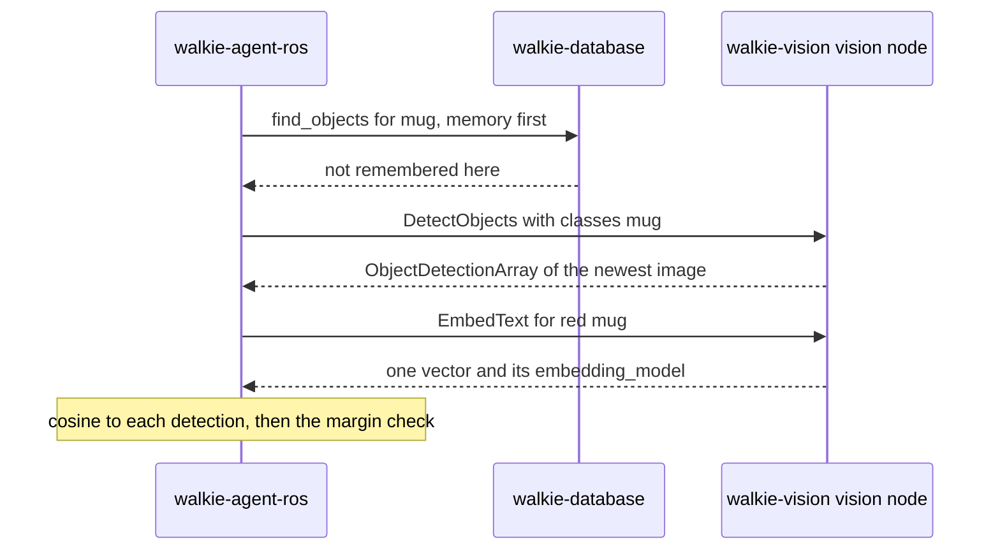

# Vision

This page explains how walkie-vision runs the robot's vision models, what
it publishes, and why it is built this way.

!!! note "What runs today"
    The vision node publishes objects and people from the head camera
    ([The vision node](#the-vision-node), [Contract](#contract)), and
    serves one person's crop on request ([Person crops](#person-crops)).
    The `EmbedText` service, object embeddings, points, object crops, room
    vectors and `DetectObjects` are not built yet.

## Summary

- walkie-vision runs the vision models of the old HTTP server,
  walkie-ai-server, and talks to the rest of the robot over ROS 2 only. It
  remembers nothing: walkie-database keeps the memory
  ([ADR-0002](decisions/0002-ros2-only-stateless.md)).
- Its messages are in `walkie_vision_msgs`, a package in this repository
  that holds only messages. walkie-database and walkie-agent-ros must build
  it too ([ADR-0003](decisions/0003-messages-in-this-repository.md)).
- All models share one Pixi environment and run in one process, the vision
  node ([ADR-0010](decisions/0010-one-vision-process.md), which supersedes
  ADR-0004).
- The node's promises to its consumers, such as one people array and one
  object array per image and track ids that a restart never reuses, are in
  the [Contract](#contract).
- The environment uses CUDA 12 builds that run on the laptops' RTX 2060 and
  the robot's RTX 50-series GPU
  ([ADR-0005](decisions/0005-cuda-12-sm75-sm120.md)).
- The face models run on ONNX Runtime with vendored InsightFace code, not
  the `insightface` package
  ([ADR-0006](decisions/0006-face-models-without-insightface.md)).
- Every `pixi run` uses Zenoh, like the rest of the robot
  ([ADR-0007](decisions/0007-zenoh-in-every-pixi-environment.md)).
- The models are proposed, pending the embedding bake-off and a measurement
  on the robot ([ADR-0008](decisions/0008-model-choices.md)).
- A new `DetectObjects` service would detect named objects in the newest
  image on request, for walkie-agent-ros's proposed self-evolving agent,
  without touching the streaming detector
  ([ADR-0009](decisions/0009-on-demand-detect-objects.md), and
  [the proposed section](#proposed-on-demand-detectobjects-for-the-self-evolving-agent)).
- `GetPersonCrop` returns one tracked person's crop from the next image,
  with other people masked and the colour shares of their top and bottom,
  for walkie-agent-ros's description of a guest
  ([ADR-0011](decisions/0011-serve-one-person-crop.md),
  [Person crops](#person-crops)).



## Processes

| Process                            | Models                                                                                                                                  | Runtime                                |
| ---------------------------------- | --------------------------------------------------------------------------------------------------------------------------------------- | -------------------------------------- |
| Vision node (`walkie_vision.node`) | YOLOE-26 segmentation with tracking, in text-prompt mode; YOLO26 pose with tracking; SCRFD and ArcFace (InsightFace's `buffalo_l`); OSNet | PyTorch and ONNX Runtime, both on CUDA |

The node also serves `GetPersonCrop`. The `EmbedText` server and the
`DetectObjects` service join this process when they are built.

Why one process ([ADR-0010](decisions/0010-one-vision-process.md)):

- **One copy of the image.** The node is the only subscriber to the raw
  camera image. An HD2K image in `bgra8` is about 11 MB, 15 times a second.
- **One CUDA context.** The models share one context instead of paying for
  two.
- **Faces at native resolution.** SCRFD runs on a crop around each
  person's head. The head position comes from the pose model, which runs
  just before it in the same process.
- **No merge step.** Each face goes into its person's `PersonDetection`
  before the array is published, so there is never a second, partial
  people array for one image.

The check `c12` runs every model in one process, the way the node loads
them, for 20 HD2K frames.

The cost: a crash in ONNX Runtime's native code stops objects and people
too, until the launch has started the node again and its models have
loaded.

Speech-to-text and text-to-speech stay in walkie-agent-ros. GraspNet,
`yolo_node` and `obb3d` stay in walkie-ros.

## The vision node

`walkie_vision.node` runs every model on the newest camera image and
publishes one people array and one object array for it. The model code
does not know about ROS: `walkie_vision.pipeline` runs the providers and
builds the messages, and the node feeds it images and publishes what it
returns. The tests run the same node with the fakes.


### Threads

- **The main thread** spins the ROS callbacks on a `MultiThreadedExecutor`
  with two threads, and the callbacks do almost nothing.
    - The image callback counts the image and puts it in a one-slot
      mailbox. A waiting image that has not been processed yet is replaced,
      so the node never works through a queue of old images.
    - The `camera_info` callback keeps the newest message.
    - The latency timer logs one summary line every 10 s. It runs on wall
      time, so it also fires under `use_sim_time` when `/clock` stops. It
      warns when the node processes under 5 Hz while the camera delivers
      more, and when another node publishes on the output topics.
    - These three stay in the node's default callback group, so they still
      run one at a time.
    - The `GetPersonCrop` callback has its own callback group. It leaves the
      request in a second one-slot mailbox and waits for the worker's
      answer, while the executor's other thread keeps running the callbacks
      above ([Person crops](#person-crops)).
    - Every 0.5 s, `main()` checks that the worker is alive and that no
      image has taken longer than `process_timeout_s`.
- **The worker thread** is the only thread that touches a model. It takes
  the newest image, waits for the rate cap (`max_rate_hz`), checks that the
  newest `camera_info` matches the image's size, converts the image, runs
  the pipeline, and publishes. When a crop request waits, the worker then
  answers it from that image and its people, and drops both.
- **Exit codes.** The node exits 1 when it fails while running: 30 failed
  images in a row, one image that takes over 60 s, or a worker that stopped.
  It exits 2 when it cannot start. A bad parameter, a missing model file,
  or OSNet not cached while offline logs one FATAL line, in about a second,
  before any model loads. A model that fails to load, for example on CUDA
  out of memory, also exits 2, and logs its traceback. The launch starts
  the node again after either.

### Parameters

All parameters are read-only, so `classes` and the topics cannot change
during a run. `config/vision.yaml` holds the defaults. `classes` has no
default: it comes from the task's file in `config/tasks/`, and a missing
list stops the node at start. `config/sim.yaml` sets `use_sim_time`, the
sim output topics and the sim crop service. Write every double with a decimal point (`10.0`, not
`10`): rclpy rejects an integer for a double parameter.

| Name                       | Type     | Default                                  | Meaning                                                                                       |
| -------------------------- | -------- | ---------------------------------------- | --------------------------------------------------------------------------------------------- |
| `image_topic`              | string   | `/zed_head/zed_node/rgb/color/rect/image` | The RGB image. On the robot: `bgra8`, 2208 x 1242, 15 Hz                                     |
| `camera_info_topic`        | string   | `/zed_head/zed_node/depth/camera_info`   | The calibration of those pixels. walkie-ros documents this topic, the sim publishes it, and `oracle_perception` reads it. The node checks its size against each image |
| `people_topic`             | string   | `/walkie_vision/people`                  | `PersonDetectionArray`                                                                        |
| `objects_topic`            | string   | `/walkie_vision/objects`                 | `ObjectDetectionArray`                                                                        |
| `person_crop_service`      | string   | `/walkie_vision/get_person_crop`         | The `GetPersonCrop` service ([Person crops](#person-crops))                                   |
| `classes`                  | string[] | none; from `config/tasks/<task>.yaml`    | YOLOE's text prompts for the whole run                                                        |
| `device`                   | string   | `cuda:0`                                 | The PyTorch and Ultralytics device: `cpu`, `cuda` or `cuda:N`. ONNX Runtime's face models always use GPU 0 |
| `objects_weights`          | string   | `yoloe-26s-seg.pt`                       | A file in `models/ultralytics/`, or an absolute path. `mobileclip2_b.ts` must be next to it  |
| `objects_imgsz`            | int      | 640                                      | A multiple of 32                                                                              |
| `objects_conf`             | double   | 0.1                                      | The detector's threshold, fed to the tracker                                                  |
| `objects_agnostic_nms`     | bool     | true                                     | One label per box                                                                             |
| `objects_tracker`          | string   | `bytetrack.yaml`                         | An Ultralytics tracker file, by name or absolute path                                         |
| `objects_min_score`        | double   | 0.25                                     | Objects under it are not published                                                            |
| `pose_weights`             | string   | `yolo26s-pose.pt`                        | Like `objects_weights`                                                                        |
| `pose_imgsz`               | int      | 640                                      | A multiple of 32                                                                              |
| `pose_conf`                | double   | 0.1                                      | The pose model's threshold, fed to the tracker                                                |
| `pose_tracker`             | string   | `botsort.yaml`                           | BoT-SORT with camera-motion compensation and no re-ID model                                   |
| `people_min_score`         | double   | 0.25                                     | People under it are not published                                                             |
| `people_dedupe_iou`        | double   | 0.5                                      | A person whose box has an IoU above this with a higher-scoring person's box is not published. 1.0 publishes every box |
| `face_det_thresh`          | double   | 0.5                                      | SCRFD's threshold. walkie-agent-ros trusts a face from 0.5                                    |
| `face_input_sizes`         | int[]    | [160, 256, 384, 640]                     | SCRFD's input sizes for the head crops                                                        |
| `face_max_people`          | int      | 6                                        | Only this many of the largest people get a face search                                        |
| `face_max_offset`          | double   | 0.25                                     | A face's centre must be within this share of the head crop's side from the head keypoints     |
| `reid_min_crop_px`         | int      | 16                                       | People with a smaller box get no appearance vector                                            |
| `reid_batch_size`          | int      | 16                                       | OSNet's batch size                                                                            |
| `max_rate_hz`              | double   | 10.0                                     | At most this many images a second; 0 means as fast as the GPU allows (bench only). Leaves GPU time for the ZED's depth |
| `max_consecutive_failures` | int      | 30                                       | Then the node exits 1, and the launch starts it again                                         |
| `process_timeout_s`        | double   | 60.0                                     | One image taking longer means the GPU hangs: the node exits 1                                 |
| `latency_log_period_s`     | double   | 10.0                                     | How often the latency line is logged, in seconds of wall time                                 |
| `stale_warn_s`             | double   | 0.5                                      | Warn when an array is older than this when it is published                                    |

Why 0.25 for both score floors: it is Ultralytics' own `predict` default,
and the trackers' `new_track_thresh` and `track_high_thresh`. A track can
only start from a box at 0.25 or more. The floor stops a track that has
started from being published while its matches score as low as
`track_low_thresh`, 0.1. walkie-agent-ros filters neither people nor seats
by score. The floors need tuning on the robot.

Why the person dedupe: YOLO26 pose is end-to-end. It has no NMS, so no IoU
setting removes overlapping boxes. Now and then it gives one person a
second, partial box, and the tracker confirms that box as its own track.
In `c11` such a box scored 0.38 to 0.41, above the 0.25 floor, with an IoU
of 0.60 to 0.65 with the real person's box. Published, it would be a third
guest for two: `find_people` would count it, `find_seats` could mark a free
seat as taken, and it could take the real person's face for that image. So
the pipeline goes through the people from the highest score down and
leaves out a person whose box has an IoU above `people_dedupe_iou` (0.5)
with a person it kept. This runs after the score floor and before the face
search. The latency line counts these as `duplicates`. A higher
`people_min_score` would also hide that box, but it would hide real people
far away or partly hidden too.

### QoS

| Topics                    | Reliability | History     | Durability |
| ------------------------- | ----------- | ----------- | ---------- |
| Image and `camera_info`   | BEST_EFFORT | KEEP_LAST 1 | VOLATILE   |
| People and objects        | RELIABLE    | KEEP_LAST 5 | VOLATILE   |
| The `GetPersonCrop` service | RELIABLE  | KEEP_LAST 10 | VOLATILE  |

RELIABLE outputs match both RELIABLE and BEST_EFFORT subscribers. The
service uses rclpy's default profile for services.
walkie-agent-ros's `VisionFeed` subscribes BEST_EFFORT.

### The latency line

Every 10 s the node logs one line like this:

```text
processed 52 in 10.0 s (5.2 Hz); received 150, replaced 98, skipped 0, failed 0, dropped 0, duplicates 0 | ms p50/p95: wait 3/9 convert 6/8 objects 21/30 pose 18/25 faces 12/40 reid 9/15 build 1/2 publish 1/2 | age 95/160
```

- **The counts** are for that period. `received` counts images that
  arrived, and `replaced` those that a newer image replaced before the
  worker took them. `skipped` counts images with no matching `camera_info`
  or an unsupported encoding. `failed` counts images on which a model
  raised. `dropped` counts single bad fields left out, such as a face with
  a broken vector. `duplicates` counts second boxes of one person that
  the dedupe left out. They are the pose model's normal behaviour, so the
  node does not warn about them.
- **The stages** are in milliseconds, as p50/p95. `wait` is the time an
  image waited in the mailbox. `faces` covers SCRFD and ArcFace on every
  head crop.
- **`age`** is the time from the image's stamp to the publish, in
  milliseconds. The contract targets under 300 at p95.

### Trackers

- Objects use ByteTrack (`objects_tracker`).
- People use BoT-SORT with `gmc_method: sparseOptFlow` and no re-ID model
  (`pose_tracker`). The base turns while the agent follows a person. The
  camera-motion compensation shifts the tracks by the camera's motion, so a
  person's box does not jump past the tracker's matching gate and get a new
  id.
- Both are parameters, so a tracker can change without a code change.
- `c11` checks it. It pastes two people into a wide textured strip and
  moves an HD2K window across it at 64 px a frame. At fx 1066 and 10 Hz
  that is a base turn of 0.6 rad/s. The published people, after the score
  floor and the dedupe, must be exactly those two in every frame, with ids
  that never change. It also prints the same pan with ByteTrack, for
  comparison.

What `c11` measured on the laptop (RTX 2060, 2026-10-26), from frame 3 on:

| Tracker   | Pan per frame | Published ids of the two people | Second boxes the dedupe left out        | Pose median, textured HD2K |
| --------- | ------------- | ------------------------------- | --------------------------------------- | -------------------------- |
| BoT-SORT  | 64 px (10 Hz) | 1 and 2 in every frame          | 2 frames (IoU 0.65, score 0.38 to 0.41) | 34.9 ms                    |
| BoT-SORT  | 128 px (5 Hz) | 1 and 2 in every frame          | 2 frames (IoU 0.65)                     | 38.2 ms                    |
| ByteTrack | 64 px (10 Hz) | 1 and 2 in every frame          | 1 frame (IoU 0.60)                      | 12.5 ms                    |
| ByteTrack | 128 px (5 Hz) | 4 ids; neither person kept one  | 1 frame (IoU 0.60)                      | 10.7 ms                    |

Without the dedupe, BoT-SORT at both rates also published a third id for
those second boxes, and the check failed.

So BoT-SORT keeps the ids at both rates, and ByteTrack loses them at 5 Hz.
Its motion estimate costs about 22 to 28 ms more per textured HD2K frame,
and about 11 ms more on a mostly black one (20.9 against 10.1 ms). Run
`pixi run python checks/run_checks.py c11` to measure again; the log is in
`checks/output/c11_providers.log`.

### GPU

- `device` moves only the PyTorch models. ONNX Runtime's face models
  always use GPU 0.
- The PyTorch models load first, then the ONNX Runtime sessions. After the
  warm-ups the node frees PyTorch's cached GPU memory, so ONNX Runtime can
  use it.
- ONNX Runtime logs only errors. SCRFD's file declares its output shapes
  for a 640 input and ArcFace's for a batch of 1, so at its default level
  ONNX Runtime warns on every smaller head crop and every batch of faces:
  about 190 lines a second with two guests at 10 Hz. `build_providers()`
  sets the level before it creates the face sessions, because a session
  takes the level when it is created.
- On the robot the ZED SDK's depth shares the GPU, and neither memory nor
  latency is measured there yet.

What `c12` measured on the laptop (RTX 2060, 2026-10-26). It loads the
models the way the node does and runs 20 HD2K frames of `zidane.jpg` with
two people:

| Measure                                        | Value                |
| ---------------------------------------------- | -------------------- |
| `build_providers()`, every model loaded and warmed up | 4.9 s         |
| `process()`, frames 3 to 20, p50 / p95         | 86.6 / 108.2 ms      |
| Stages p50 / p95: objects, pose, faces, reid   | 13.6 / 26.5, 22.8 / 28.4, 34.8 / 37.0, 13.8 / 16.9 ms |
| GPU memory after the loop, nvidia-smi          | 862 MiB              |
| PyTorch reserved / max allocated               | 198 / 173 MiB        |

Run `pixi run python checks/run_checks.py c12` to measure again; the log is
in `checks/output/c12_vision_node.log`.

### First start

On a GPU that ONNX Runtime has no machine code for, such as an RTX 50, the
face warm-up compiles the kernels and can take minutes. The log says
"warming up the face models" first. The driver keeps the compiled kernels
in `~/.nv/ComputeCache`, so later starts are fast while that folder is
kept.

## Contract {#contract}

What the vision node promises its consumers. walkie-agent-ros and
walkie-database can cite each item by its link.

### One pair per image {#contract-pairs}

- For every image it processes, the node publishes exactly one
  `PersonDetectionArray` on `people_topic` and one `ObjectDetectionArray`
  on `objects_topic`, also when they are empty.
- Both carry the image's own header: the same stamp and the camera's
  optical `frame_id`.
- Both carry a copy of the matching `camera_info` with that header.
- People are published first. Consumers pair by exact stamp:
  walkie-agent-ros's `find_seats` waits up to 0.5 s.
- If a model fails on an image, neither array is published for it. There
  is never a second or partial array for one stamp.
- A single bad field does not fail the image. A bad face or appearance
  vector is left out of that person, and a person or object with a bad box
  is left out. The node logs the counts.

### Who publishes {#contract-publishers}

- On the robot, the vision node is the only publisher on
  `/walkie_vision/people` and `/walkie_vision/objects`.
- In simulation, walkie-agent-ros's `oracle_perception` owns those topics.
  The node, if it runs there, publishes on `/walkie_vision/sim/people` and
  `/walkie_vision/sim/objects`.
- The node warns when another node publishes on its output topics.

### Scores {#contract-scores}

- Every published person scores at least `people_min_score`, and every
  object at least `objects_min_score`. Both are 0.25.
- No published person's box has an IoU above `people_dedupe_iou` (0.5)
  with the box of a higher-scoring published person. A second box of one
  person is left out. Two real people who overlap that much show as one.

### Faces {#contract-faces}

- Each person's face is in that person's `PersonDetection`.
- `face_det_score` 0 means no face, with an empty `face_model` and
  `face_embedding` and a zero `face_bbox`.
- A face has `face_det_score >= 0.5` (SCRFD's threshold),
  `face_model = arcface_w600k_r50`, and a unit 512-value `face_embedding`.
- `face_bbox` is in whole-image pixels and clipped to the image. Its centre
  is within `face_max_offset` (0.25) of the head crop's side from the
  person's head keypoints. No face is given to two people.
- `appearance_model = osnet_x1_0_msmt17`, with a unit 512-value vector, for
  every person whose clipped box is at least 16 x 16 px.

### Track ids {#contract-track-ids}

- Every person and object from the real models has a non-zero `track_id`.
  It stays the same while the tracker keeps the track: 30 processed frames
  after the last match.
- A new person or object appears one processed frame after it is first
  seen, except on the first image after the node starts.
- Person tracks use camera-motion compensation (BoT-SORT's
  `sparseOptFlow`, no re-ID model), so a base turn at 0.6 rad/s at 10 Hz
  keeps the published people's ids (`c11`, with the dedupe).
- An object's label can change between images under the same id, for
  example from `chair` to `armchair`.
- Ids are `((offset + local - 1) mod (2^32 - 1)) + 1`, where `offset` is
  the Unix time in ms at node start, mod (2^32 - 1). So a restart never
  reuses an id, unless the system clock steps back further than the time
  between the two starts.
- Object ids and person ids are separate spaces.
- Treat ids as opaque.
- 0 still means "not tracked", for other publishers such as the fakes.

### Classes {#contract-classes}

- `classes` is read once from the task's parameter file and never changes
  during a run. Changing it means restarting the node.
- A class in `classes` without a detection was not seen.
- HRI: `chair, sofa, armchair, stool`.

### Geometry {#contract-geometry}

- Boxes, keypoints and faces are in pixels of the published `camera_info`.
  Its width and height equal the image's: the node skips an image
  otherwise.
- Boxes and keypoints are clipped to the image. Keypoints are scored by
  `keypoint_scores` and are not zeroed below any score. Use a score floor:
  the agent uses 0.3.
- `frame_id` is the camera's optical frame (z forward, x right).
- Headings come from `k[0]` and `k[2]`. Face size in radians comes from
  `k[0]` and `k[4]`. Left, centre and right are thirds of
  `camera_info.width`.

### Freshness {#contract-freshness}

- The node processes only the newest image. It drops images rather than
  queueing them.
- The targets: at least 5 Hz, and an age at publish (stamp to publish)
  under 0.3 s at p95. Then the gap between two sightings of a person stays
  under 2 x 0.2 + 0.3 = 0.7 s, inside the agent's 1 s.
- The node caps itself at 10 Hz (`max_rate_hz`) to leave GPU time for the
  ZED's depth.
- It logs per-stage latency (p50/p95) and the age at publish every 10 s.
  It warns when an array is older than 0.5 s at publish, and when it
  processes under 5 Hz while the camera delivers more.
- Consumers drop arrays older than 1 s. walkie-agent-ros's gaze loses a
  person 1 s after the last sighting.
- The targets are measured on the laptop (`c12`), not yet on the robot.

### Face resolution {#contract-face-resolution}

- SCRFD runs on a crop around each person's head, from the pose keypoints,
  at native resolution, for the 6 largest people.
- At fx 1066, the agent's 0.0469 rad gate is about 50 px, and
  `FrontConfig`'s 0.10 rad is about 107 px. Both are well inside what SCRFD
  sees in a crop.

### QoS {#contract-qos}

- The outputs are RELIABLE, KEEP_LAST 5, VOLATILE. BEST_EFFORT subscribers,
  such as the agent's `VisionFeed`, match too.
- The inputs are BEST_EFFORT, KEEP_LAST 1.

## Person crops {#person-crops}

`GetPersonCrop` returns one tracked person's crop from the next image, with
other people greyed and the colour shares of the person's top and bottom
([ADR-0011](decisions/0011-serve-one-person-crop.md)). walkie-agent-ros
plans to use it to describe the first guest to the second guest. The crop
is the "compressed snapshot on request" of walkie-agent-ros ADR-0028, so the
agent never subscribes to the camera image. The pure code is in
`walkie_vision.crop`, with no ROS and no model.

### Serving

- The node serves `GetPersonCrop` on `person_crop_service`:
  `/walkie_vision/get_person_crop` on the robot, and
  `/walkie_vision/sim/get_person_crop` with `sim:=true`. In simulation,
  walkie-agent-ros's track ids come from `oracle_perception`, not from this
  node, so the node leaves `/walkie_vision/get_person_crop` to the
  simulation.
- The request names a track id from `/walkie_vision/people`. The service
  callback checks the request, leaves it in a one-slot mailbox and waits up
  to `timeout_s` of wall time. It never runs a model or touches an image.
- The worker takes the request as soon as an image's people are found. It
  publishes that image's two arrays first, and then answers from that image
  and the people it published for it. So the crop, its keypoints, the
  colour shares and the person all come from one image, and the response's
  `header` is that image's header, the same as its people array's. A
  request that arrives while the worker is on an image, before its people
  are found, is answered from that image.
- The node answers one request at a time. `timeout_s` must be more than 0
  and at most 5 s, so a waiting request never holds the next one for long.
- Nothing is kept after the answer
  ([ADR-0002](decisions/0002-ros2-only-stateless.md)): the worker drops the
  image and its people as soon as it has answered.
- Every answer logs one line like this, with the status, the time from the
  request to the answer, and for OK the JPEG's size:

```text
person crop for track 1761234567: OK in 84 ms, 41 KB
```

### Statuses

The status constants are on `GetPersonCrop.Response`. Only OK fills the
crop, its keypoints, `masked_boxes` and the colour shares.

| Status        | When                                                              | Also filled                           |
| ------------- | ----------------------------------------------------------------- | ------------------------------------- |
| `OK`          | The crop was made                                                 | Everything                            |
| `NOT_IN_VIEW` | The track is not among the image's people                         | `header`                              |
| `OCCLUDED`    | A nearer person hides this one ([Occlusion](#occlusion))          | `header`, `person`, `max_overlap`, `torso_cover` |
| `TOO_SMALL`   | The person's box is under 160 px tall                             | `header`, `person`, `max_overlap`, `torso_cover` |
| `TIMEOUT`     | Images arrived, but none was processed within `timeout_s`         | Nothing                               |
| `NO_IMAGE`    | No image arrived within `timeout_s`                               | Nothing                               |
| `FAILED`      | A refused request (track id 0, an option out of range), a node that is shutting down, or a crop that raised | Nothing |

`message` says why for every status but OK. The checks run in the order of
the table: a person who is both hidden and small is `OCCLUDED`.

### Occlusion {#occlusion}

Box overlap alone cannot tell a person in front from a person behind. In
walkie-agent-ros's HRI scenario, a bystander stands behind the guest's spot
in the door view. With the guest at rest, the bystander's box covers about
37% of the guest's torso width, at its full height, and while the guest
paces the cover stays above 30% for about half of the cycle. A plain
overlap gate would mark most views as occluded. So only a nearer person
counts:

- **Nearer.** Another person is nearer when their box ends lower in the
  image than this person's by at least 3% of the image height, because
  their feet are closer to the camera. A box cut off by the image's bottom
  edge is nearer than one that is not.
- **Both cut off.** When both boxes are cut off at the bottom, the other
  person is nearer only when one of this person's four torso keypoints
  inside their box scores under `min_keypoint_score`: they hide it.
- **OCCLUDED** when a nearer person's box has an IoU above 0.3 with this
  person's box (`max_overlap`), or covers more than 30% of this person's
  torso box, the box around the shoulder and hip keypoints
  (`torso_cover`). The second test catches a smaller person in front, whose
  IoU stays low.
- People behind are only masked.

The test reads only box bottoms and keypoint scores. It assumes that
people stand on one floor in front of the camera.

### The mask

- With `mask_others`, every other detected person's box inside the crop,
  minus this person's own box, is filled with grey (128 in every channel).
  A box minus a box is up to 4 rectangles. `masked_boxes` lists them, in
  pixels of the crop.
- This person's own box is never greyed, so a person behind does not cut
  into their pixels.
- The residual: another person's pixels inside this person's box, and
  people the detector missed, stay in the crop. Keypoint silhouettes of the
  other people could tighten the mask later.

### Colour shares

The node measures the colours on the robot, on the image's own pixels
before the crop is scaled and compressed. That is more accurate than
measuring them on the JPEG, and it works without the network.

- **Regions.** The top is the polygon through the shoulders and the hips,
  shrunk by 20% towards its centre, away from the arms and the background.
  The bottom is the polygon through the hips and the knees. Both are
  clipped to this person's box, and greyed pixels are left out, not counted
  as grey.
- **Gates.** A region gets no shares when one of its four keypoints scores
  under `min_keypoint_score`, or when fewer than 50 of its pixels are left.
  There is no fallback to a share of the box.
- **`top_left` and `bottom_left`** are the share of each region's pixels
  left after clipping and masking.
- **`color_names`** are the 12 colours of walkie-agent-ros's schema,
  without `unknown`: black, white, grey, red, orange, yellow, green, blue,
  purple, pink, brown and beige. The shares follow that order and sum to 1.
- **The bins.** Each pixel goes to the first rule that holds, on OpenCV's
  HSV with the hue in degrees and saturation and value from 0 to 1:

| Rule                                         | Colour |
| -------------------------------------------- | ------ |
| v < 0.22                                     | black  |
| s < 0.18 and v ≥ 0.75                        | white  |
| s < 0.18                                     | grey   |
| hue under 15 or from 345, s < 0.45 and v ≥ 0.60 | pink |
| hue under 15 or from 345                     | red    |
| hue 15 to 45 and v < 0.65                    | brown  |
| hue 15 to 45 and s < 0.45                    | beige  |
| hue 15 to 45                                 | orange |
| hue 45 to 70 and s < 0.45                    | beige  |
| hue 45 to 70 and v < 0.65                    | brown  |
| hue 45 to 70                                 | yellow |
| hue 70 to 165                                | green  |
| hue 165 to 260                               | blue   |
| hue 260 to 300                               | purple |
| hue 300 to 345 and v < 0.55                  | purple |
| anything else                                | pink   |

Each hue range includes its lower end and excludes its upper end.

### The crop

The crop is the person's box, padded on each side by `padding` (0.10) of
its width or height and clipped to the image. It is scaled down with
`INTER_AREA` so that its longer side is at most `max_side` (512 px), never
up, and encoded as a JPEG at quality 90. `crop_keypoints` are the 17
keypoints in pixels of that crop.

### Off the robot

This repository sends nothing off the robot. walkie-agent-ros sends the
crop to a cloud vision-language model (VLM) for enum answers, such as the
type of the top, and cross-checks the colours against these shares. Under
[the Restaurant constraint](#the-restaurant-constraint) the shares alone
must do when the network is down.

The cloud VLM is External Computing. It is declared to the Technical
Committee one month ahead, with all External Computing
(`ExternalDevices.tex:18`), and shown at Robot Inspection in addition.

`GetPersonCrop` is not the service of
[open question 6](#open-questions), which stays open. This is a deviation
from that question: question 6 asks for one annotated full image, with
numbered boxes, and its text regions masked at Competition level.
`GetPersonCrop` uploads one masked crop of one person, for enum answers
only, without text masking.

### Not measured yet

The thresholds are first values: the 3% margin, the two 0.3 gates, the
160 px floor, the 20% shrink, the 50-pixel floor and the HSV bins. They are
to be tuned on photos from the robot. On the robot, with HD2K images at
15 Hz, the checks are:

- the time from request to answer is at most 300 ms, and the JPEG at most
  80 KB;
- the colour shares are returned;
- the image rate does not drop during requests: the crop runs on the
  worker after the arrays are published, and the next image waits for it;
- the head camera sees the lower-body keypoints at door distance, so the
  bottom region is not gated;
- with one person behind the guest and one in front, only the one in front
  gives `OCCLUDED`.

## How to run

1. `pixi run fetch-models` downloads the model files into `models/`.
2. `pixi run build-msgs` builds `walkie_vision_msgs`.
3. Run once with internet access, so OSNet's checkpoint reaches the
   Hugging Face cache. The node checks the cache at start and fails in
   about a second without it.
4. A Zenoh router must run, with the same `ROS_DOMAIN_ID` as the rest of
   the robot.
5. `pixi run vision` starts the node with the HRI task's classes, and
   starts it again whenever it exits. Add `task:=<task>` for another task,
   and `sim:=true` in simulation.

[Run the vision node](../guides/vision-node.md) has the details and a
troubleshooting table.

## Topics and services

Published and served:

| Name                        | Type                                      | What it is                                         |
| --------------------------- | ----------------------------------------- | -------------------------------------------------- |
| `/walkie_vision/objects`    | `walkie_vision_msgs/ObjectDetectionArray` | Every object in each processed image, also when there is none |
| `/walkie_vision/people`     | `walkie_vision_msgs/PersonDetectionArray` | Every person in each processed image, also when there is none |
| `/walkie_vision/sim/objects` and `/walkie_vision/sim/people` | The same types | The node's output with `sim:=true`. In simulation, walkie-agent-ros's `oracle_perception` owns the two topics above ([Who publishes](#contract-publishers)) |
| `/walkie_vision/get_person_crop` | `walkie_vision_msgs/srv/GetPersonCrop` | One tracked person's crop and colour shares from the next image ([Person crops](#person-crops)) |
| `/walkie_vision/sim/get_person_crop` | `walkie_vision_msgs/srv/GetPersonCrop` | The same service with `sim:=true`, for this node's own track ids |
| `/walkie_vision/embed_text` | `walkie_vision_msgs/srv/EmbedText`        | Not built. Text embeddings in the object embedder's space, for search |
| `/walkie_vision/detect_objects` | `walkie_vision_msgs/srv/DetectObjects` | Proposed, not built ([ADR-0009](decisions/0009-on-demand-detect-objects.md)). Named objects in the newest image, on request |

Subscribed, from walkie-ros's ZED driver. Both topics are parameters:

| Parameter           | Default                                   | Type                       |
| ------------------- | ----------------------------------------- | -------------------------- |
| `image_topic`       | `/zed_head/zed_node/rgb/color/rect/image` | `sensor_msgs/Image`, `bgra8`, 2208 x 1242 at 15 Hz on the robot |
| `camera_info_topic` | `/zed_head/zed_node/depth/camera_info`    | `sensor_msgs/CameraInfo`   |

Both the robot and the sim publish `depth/camera_info`. The robot's
`rgb/color/rect/camera_info` is not checked yet. The node skips any image
whose size does not match the `camera_info`, so a wrong topic shows as
skipped images in the latency line. The node does not subscribe to the
depth image yet.

## Messages

Every field is commented in its file in
`ros2_ws/src/walkie_vision_msgs/`. [Add the Message Package](../setup/02-message-package.md)
explains the rules behind them.

### ObjectDetectionArray

| Field         | Type                     | What it is                                                         |
| ------------- | ------------------------ | ------------------------------------------------------------------ |
| `header`      | `std_msgs/Header`        | The stamp and camera frame of the image                            |
| `camera_info` | `sensor_msgs/CameraInfo` | The calibration of the image the boxes are in                      |
| `classes`     | `string[]`               | The text prompts the detector looked for. A class without a detection was not seen. |
| `detections`  | `ObjectDetection[]`      | The objects                                                        |

### ObjectDetection

| Field             | Type                          | What it is                                                              |
| ----------------- | ----------------------------- | ----------------------------------------------------------------------- |
| `label`           | `string`                      | One of the array's `classes`                                            |
| `score`           | `float32`                     | The detector's confidence, 0 to 1                                       |
| `track_id`        | `uint32`                      | The tracker's id, stable while the track lasts. 0 means not tracked.    |
| `bbox`            | `vision_msgs/BoundingBox2D`   | The box, in float pixels. `center.theta` is 0.                          |
| `embedding_model` | `string`                      | The `<model>` part of walkie-database's table name, for example `clip_vit_b16` |
| `embedding`       | `float32[]`                   | The unit-length embedding of the image inside `bbox`. Empty, with an empty model name, when none was computed. |
| `points`          | `sensor_msgs/PointCloud2`     | The object's points, cut out of the depth image with its mask, in `points.header.frame_id`. Empty without depth. |
| `crop`            | `sensor_msgs/CompressedImage` | The image inside `bbox`. Optional.                                      |

### PersonDetectionArray and PersonDetection

`PersonDetectionArray` has `header`, `camera_info` and `people`. One
`PersonDetection`:

| Field                   | Type                        | What it is                                                     |
| ----------------------- | --------------------------- | -------------------------------------------------------------- |
| `score`                 | `float32`                   | The person detector's confidence                               |
| `track_id`              | `uint32`                    | The tracker's id. 0 means not tracked.                         |
| `bbox`                  | `vision_msgs/BoundingBox2D` | The box around the whole person                                |
| `keypoints`             | `float32[34]`               | x and y of the 17 COCO keypoints, in COCO order                |
| `keypoint_scores`       | `float32[17]`               | The confidence of each keypoint                                |
| `face_bbox`             | `vision_msgs/BoundingBox2D` | The face, when one was found                                   |
| `face_det_score`        | `float32`                   | The face detector's confidence. 0 when there is no face.       |
| `face_model`            | `string`                    | For example `arcface_w600k_r50`. Empty when there is no face embedding. |
| `face_embedding`        | `float32[]`                 | The unit-length face embedding                                 |
| `appearance_model`      | `string`                    | For example `osnet_x1_0_msmt17`                                |
| `appearance_embedding`  | `float32[]`                 | The unit-length appearance embedding of the person's image     |

### EmbedText

| Part     | Field             | Type        | What it is                                                     |
| -------- | ----------------- | ----------- | -------------------------------------------------------------- |
| Request  | `texts`           | `string[]`  | The texts to embed. At least one.                              |
| Response | `success`         | `bool`      | False when nothing was embedded                                |
| Response | `message`         | `string`    | Why, when `success` is false                                   |
| Response | `embedding_model` | `string`    | The model, named as in `ObjectDetection.embedding_model`       |
| Response | `dim`             | `uint32`    | The length of each vector                                      |
| Response | `vectors`         | `float32[]` | One unit-length vector per text, one after another             |

walkie-database does not run models (walkie-database ADR-0006), so a text
search such as "a red mug" asks this service for the vector first, then
searches the table that `embedding_model` names.

### GetPersonCrop

The status constants, `OK` to `FAILED`, are on the response
([Statuses](#statuses)).

| Part     | Field                | Type                          | What it is                                                     |
| -------- | -------------------- | ----------------------------- | -------------------------------------------------------------- |
| Request  | `track_id`           | `uint32`                      | The person's track id, as published. 0 is refused.             |
| Request  | `padding`            | `float32`                     | Each side of the box grows by this share of its size. 0.10, from 0 to 1. |
| Request  | `max_side`           | `uint16`                      | The crop's longer side at most, in pixels. 512, at least 1.    |
| Request  | `mask_others`        | `bool`                        | Grey the other people's boxes. True.                           |
| Request  | `min_keypoint_score` | `float32`                     | A keypoint under it counts as hidden. 0.5, from 0 to 1.        |
| Request  | `timeout_s`          | `float32`                     | How long to wait for an image, in seconds of wall time. 1.0, more than 0 and at most 5. |
| Response | `status`             | `uint8`                       | One of the status constants                                    |
| Response | `message`            | `string`                      | Why, for every status but OK                                   |
| Response | `header`             | `std_msgs/Header`             | The header of the image that answered, as on its people array  |
| Response | `person`             | `PersonDetection`             | The person as published for that image                         |
| Response | `crop`               | `sensor_msgs/CompressedImage` | The crop, a JPEG at quality 90                                 |
| Response | `crop_keypoints`     | `float32[]`                   | The 17 keypoints, x and y, in pixels of the crop               |
| Response | `masked_boxes`       | `float32[]`                   | The greyed rectangles, x0, y0, x1, y1, in pixels of the crop   |
| Response | `max_overlap`        | `float32`                     | The largest IoU of a nearer person's box with the person's box |
| Response | `torso_cover`        | `float32`                     | The largest share of the person's torso box that a nearer person covers |
| Response | `color_names`        | `string[]`                    | The 12 colour names, in the shares' order                      |
| Response | `top_shares`         | `float32[]`                   | The share of each colour in the torso. Empty when gated.       |
| Response | `bottom_shares`      | `float32[]`                   | The same for the thighs                                        |
| Response | `top_left`           | `float32`                     | The share of the torso's pixels left after clipping and masking |
| Response | `bottom_left`        | `float32`                     | The same for the thighs                                        |

## The model code

| Module                      | What it holds                                                                     |
| --------------------------- | --------------------------------------------------------------------------------- |
| `walkie_vision.providers`   | The interfaces every model implements (`ObjectDetector`, `Embedder`, `PoseEstimator`, `ReIdentifier`, `FaceRecognizer`, `PersonFaceRecognizer`), their result types, and the model names |
| `walkie_vision.fakes`       | A fake for each interface, with deterministic vectors, for tests without a GPU (`FakePersonFaceRecognizer` among them), and painted figures for the crop tests (`figure_pose`, `paint_figure`) |
| `walkie_vision.convert`     | Model results to messages, with the checks the message comments state             |
| `walkie_vision.yolo`        | YOLOE-26 and YOLO26 pose with their trackers (`YoloeTracker`, `YoloPoseTracker`)  |
| `walkie_vision.face`        | SCRFD and ArcFace on ONNX Runtime (`FaceAnalyzer`, a `FaceRecognizer`)            |
| `walkie_vision.face.heads`  | Faces from crops around each person's head (`HeadFaceRecognizer`, a `PersonFaceRecognizer`) |
| `walkie_vision.reid`        | OSNet x1.0 and its weights (`load_osnet`)                                         |
| `walkie_vision.reid.identifier` | OSNet on person crops (`OSNetReIdentifier`, a `ReIdentifier`)                 |
| `walkie_vision.models`      | Every model file and Hugging Face commit, with its checksum and licence           |
| `walkie_vision.image`       | `sensor_msgs/Image` to a BGR array, and the `camera_info` size check              |
| `walkie_vision.pipeline`    | One image through every provider to the two arrays, with the score floors, the person dedupe (`dedupe_poses`) and the track id base. No ROS node |
| `walkie_vision.crop`        | One person's crop for `GetPersonCrop` (`crop_person`): the nearer test, the gates, the mask and the colour shares. No ROS node and no model |
| `walkie_vision.node`        | The vision node: parameters, threads, publishing, health checks and `build_providers` |

The node holds one provider for each model, and `pipeline` uses `convert`
to build what they return into messages. The tests run the same path with
the fakes, so the node is tested without a GPU.

## The Restaurant constraint

The RoboCup@Home 2026 rulebook (revision 2025-12-01) says in the Restaurant
test (section 5.5) that the availability of wireless and of external
computing devices "can't be guaranteed. Assume unavailability." Section
3.4.1 adds that robots must be able to operate safely without external
computing.

So every model that a test depends on runs on the robot's own GPU. A cloud
model may only add to what the robot can already do on board.

## Proposed: on-demand DetectObjects for the self-evolving agent

!!! note "Status: Proposed"
    Nothing in this section is built or accepted. It records what
    walkie-agent-ros's proposed self-evolving agent asks of this
    repository, and the proposed
    [ADR-0009](decisions/0009-on-demand-detect-objects.md).

walkie-agent-ros plans to turn its agent into a self-evolving agent
(walkie-agent-ros `docs/architecture/self-evolving-agent.md`, Proposed).
The agent gets small typed tools, called atomics, which it chains into
bundles. It also writes new tools of its own. In simulation these are
drafts, which a human reviews before they are kept. At competitions, when
the run profile allows it and the robot is online, it may write tools for
the current session that only read, perceive and speak.

Generated tools run at one of three access levels (walkie-agent-ros
`docs/architecture/access-levels.md`, Proposed). Unrestricted and Standard
run only in simulation. Competition, the default, is the only level
allowed on the real robot.

Two of the agent's perception atomics call walkie-vision:

- `detect_objects` asks a new `DetectObjects` service to detect named
  objects in the newest image.
- `search_detections` asks the existing `EmbedText` service for the vector
  of a description such as "red mug", and ranks the detections with it.

Both atomics are planned. Both are also in the small set that generated
tools may call at Competition level, so generated code on the robot can
reach these services, but only through the atomics. The work in this
repository is listed in
[What changes in this repository](#what-changes-in-this-repository).

### How the agent finds an object

The agent looks in memory first, then looks with the camera, then narrows
the result down. Every step runs on the robot. The full cascade is on
walkie-agent-ros's page (`docs/architecture/self-evolving-agent.md`,
"Finding objects with search_detections"). The part that involves
walkie-vision:



| Agent tool          | What walkie-vision does                                                          |
| ------------------- | -------------------------------------------------------------------------------- |
| `detect_objects`    | `DetectObjects` detects the nouns with YOLOE in the newest image. It returns boxes, embeddings, points and crops. |
| `search_detections` | `EmbedText` embeds the description and the noun as one text. The agent computes the cosine and the margin. |
| `localize_object`   | Nothing at run time. It reads the detection's `points` and the array's `header`. |

The other steps need no walkie-vision service. `find_objects` asks
walkie-database's memory, `relate_objects` computes relations from
positions in `base_footprint`, and `wait_for_person` asks the person. Of
these six tools, only `find_objects` exists today. The other five are
planned.

The agent's tool calls already separate the noun ("mug") from the
attributes ("red"), and a separate tool takes the relation ("the left
one"). Only the noun goes to the detector. Only the attributes and the noun
go to `EmbedText`. Relations such as leftmost, nearest or `left_of` are
computed from positions, because CLIP-family models are near chance on
spatial words. `search_detections` ends in one of three ways: one match,
up to 3 candidates that the agent resolves with `relate_objects` or a
question, or nothing found with the labels it saw.

The 3D position of a found object is worked out robot-side, with TF looked
up at the image's stamp: by walkie-ros perception now, and later by
walkie-database once it ingests detections. Which walkie-ros interface
serves it is not settled. walkie-ros has no point-cloud-to-map service
today: its `cloud_to_map` node republishes the whole ZED cloud in `map`,
and `/get_3d_poses` samples its own newest depth image rather than a
detection's points.

### detect_objects and DetectObjects

`detect_objects` passes one or more nouns. A bundle can add a second noun,
for example the anchor of "the cup left of the plate". The proposed
service is below, at sketch level. The exact `.srv` is left to the
implementation ([ADR-0009](decisions/0009-on-demand-detect-objects.md)).

| Part     | Field     | Type                   | What it is                                                     |
| -------- | --------- | ---------------------- | -------------------------------------------------------------- |
| Request  | `classes` | `string[]`             | The nouns to look for, for example `mug`. At least one.        |
| Response | `success` | `bool`                 | False when the request could not be served                     |
| Response | `message` | `string`               | Why, when `success` is false                                   |
| Response | `objects` | `ObjectDetectionArray` | The detections in the newest image. Its `classes` are the request's nouns. |

How it would run:

- **On the newest image.** The vision node is the only subscriber to the
  camera, and holds only the newest RGB image and `camera_info`. For this
  service it would also hold the newest depth image, which it does not
  subscribe to yet. The service reads those and adds no subscriber.
  It keeps no image and no detection after it answers. Only the on-demand
  model's last class list stays loaded, as a cache. It returns no id for
  the image.
- **With everything the topic carries.** Every detection has its box, its
  embedding from the object embedder, its points and, when the topic sends
  one, its crop, as on `/walkie_vision/objects`. The array's `header` is
  the image's stamp and frame, not the time of the answer.
- **On its own YOLOE instance, without a tracker.** The streaming detector
  keeps its classes and its tracks. On-demand detections have `track_id` 0.
- **To the caller only.** The result is not published on
  `/walkie_vision/objects`.

**No frame handles.** A `capture_frame` tool that returns an RGBD image
was considered for the agent, and folded into `detect_objects`. A
robot-side frame kept for later calls would make walkie-vision stateful,
which [ADR-0002](decisions/0002-ros2-only-stateless.md) rules out. Keeping
the raw frame in the agent instead conflicts with walkie-agent-ros
ADR-0028 (Proposed), which keeps raw camera images out of the agent and
allows only one compressed snapshot on request. An HD2K frame is about
11 MB, and it must not reach the LLM.

**Why not re-prompt the streaming detector.** The obvious way to detect a
new noun is to add it to the streaming detector's text prompts. It costs
too much:

| Cost                         | Why                                                                               |
| ---------------------------- | --------------------------------------------------------------------------------- |
| About 1.5 s per new list     | `set_classes()` with 5 names took 1.5 s on the RTX 2060 ([Measured on the RTX 2060](../setup/01-vision-environment.md#measured-on-the-rtx-2060)). In the installed Ultralytics 8.4.182, it loads the text encoder again on every call that changes the list. |
| Track ids may reset          | `ObjectDetector` in `walkie_vision.providers` allows it. In Ultralytics 8.4.182, `set_classes()` drops the predictor, and the trackers live on the predictor (read in the code, not tested). |
| The `classes` field changes  | A class in `classes` without a detection was not seen (`ObjectDetectionArray.msg`). While the caller's nouns replace the task's list, walkie-database would read every task class as "not seen" when it was only "not looked for". |
| Restoring the list costs again | Setting the old list back pays the 1.5 s again and resets the tracks again. Two callers at once would fight over one list. |

A second instance avoids the last three. It still pays the 1.5 s for each
new list, but on the caller's request instead of stalling the streaming
detector. It also costs GPU memory, which is not measured yet. A request
with the same list as the one before skips the text encoder, so repeated
searches for the same noun stay fast.

**What the agent does with the answer.** walkie-agent-ros keeps the
response in its own handle store, under an id such as `det_3f2a`, with the
image's stamp and frame and the robot's pose when the image was taken. Its
LLM sees only labels, scores and handle ids. A handle goes stale when the
base has moved more than 5 cm or 3° since the image, with a soft limit of
10 minutes. That is why the `header` stamp must be the image's own.

### search_detections and EmbedText

`EmbedText` is already designed ([EmbedText](#embedtext)).
`search_detections` sends the description and the noun as one text, such
as "red mug", and computes the cosine between that vector and each
detection's embedding.

- **One model.** The vectors are comparable only when `EmbedText`'s
  `embedding_model` equals the detections' `embedding_model`. The agent
  must check that, and never rank across two models. The model names in the
  messages exist for exactly this.
- **A minimum score and a margin.** Below a minimum score the answer is
  `NOT_FOUND`, with the labels seen. Above it, the best match must lead the
  second best by at least 0.05, or the answer is `AMBIGUOUS`, with up to 3
  candidates. Both values are to be tuned on the bake-off data.
- **Tuned per model.** The bake-off guide warns that margins compare only
  within one model ([Embedding bake-off](../guides/bakeoff.md)). The
  object embedder is still open: SigLIP 2 is proposed, EmbeddingGemma 2 is
  the challenger, and CLIP ViT-B/16 stays the baseline until the bake-off
  decides ([ADR-0008](decisions/0008-model-choices.md)). When it changes,
  the agent's minimum score and margin must be tuned again.
- **A deadline.** In the agent's design sketch, `search_detections` has a
  3 s timeout, and its example traces show `EmbedText` timing out after
  2 s. Both are example values, not settled. `EmbedText` must answer well
  inside them.

**Not for tool search.** The agent also searches its own catalogue of
tools, with a hybrid keyword and vector index (walkie-agent-ros ADR-0046,
Proposed). It deliberately does not use `EmbedText` for the vectors. The
object embedder is an image-text model with a short text context and no
task prompt, and tool search would then depend on the vision service. The
agent runs its own small text-embedding model on the CPU instead: the
proposed candidate is `qwen3-embedding:0.6b`. So `EmbedText` serves object
search only, and a new object embedder never touches the tool index.

### In simulation

walkie-agent-ros's sim harvest runs its agent in MuJoCo (walkie-agent-ros
`docs/architecture/harvest.md`, Proposed). There, walkie-agent-ros's
`oracle_perception` node (`src/walkie_agent/sim/oracle_perception.py`)
publishes detections from the scenario's spec, with configurable noise and
dropout, in `walkie_vision_msgs` types. People come only from that node,
because the sim world has no person bodies. Whether that node, or
something else, also answers `DetectObjects` and `EmbedText` in sim is not
decided (open question 7).

walkie-agent-ros copies `hash_vector` into
`src/walkie_agent/sim/fake_vectors.py`. Its `oracle_perception` and its
tests use it, so their ranking is deterministic. `hash_vector` is now
something another repository relies on. A change to how it derives vectors
must be matched in walkie-agent-ros, or the rankings in its tests change
without an error.

Hash vectors match only on equal input. `hash_vector` gives equal vectors
for equal bytes and nearly orthogonal vectors otherwise, and
`FakeEmbedder` prefixes texts with `b"text "` and images with
`b"image "`. So a `FakeEmbedder` text vector never matches a
`FakeEmbedder` image vector. If the sim detections carried image vectors,
a minimum-score check would always answer `NOT_FOUND`. For a sim search to
find anything, the detection embeddings must be hashed from the same key
as the query text.

The vision node can run on the rendered MuJoCo frames with
`pixi run vision sim:=true`. It then publishes on `/walkie_vision/sim/people`
and `/walkie_vision/sim/objects`, so its arrays never mix with
`oracle_perception`'s. The agent does not read those topics: they are for
looking at the node's output on rendered frames. MuJoCo has no person
bodies, so the node finds no people there.

### What walkie-agent-ros builds against

- **The message package.** walkie-agent-ros pins this repository in its
  `ros2_ws.repos` (b050ea1 when this was written) and builds
  `walkie_vision_msgs` in `build-ros2`, as it does `walkie_database_msgs`
  (walkie-agent-ros ADR-0034).
- **The real clients.** `DetectObjects` and `EmbedText` clients are a
  parallel track, from phase 2 of the agent's roadmap, and the agent's
  bundle tests are rerun against them. Until then its presets stay backed
  by mocks, and a real run refuses to start with a mock backend.
- **The fields.** The agent's mocks and `oracle_perception` copy the
  `walkie_vision_msgs` fields. So a field change here also needs a matching
  change there, not only a rebuild of the package. The bundle tests rerun
  against the real clients catch drift.
- **Field names.** When a generated tool reads a ROS message, the agent's
  bridge finds any nested `Image`, `CompressedImage` or `PointCloud2`
  field, and any `float32[]` field whose name ends in `embedding`. At
  Standard level it drops them. At Unrestricted level it turns them into
  handles. At Competition level, generated tools get no raw ROS at all, and
  perception atomics return labels, counts and enums only: no OCR and no
  captions. So a new vector field in `walkie_vision_msgs` must end in
  `embedding`, and images and point clouds must use the `sensor_msgs`
  types, or the bridge misses them.
- **An exception today.** `EmbedText`'s `vectors` field does not follow
  that rule. Standard cannot call `EmbedText`: its read-only service list
  does not include it. At Unrestricted, any service off the never-list may
  be called, so the vectors would pass through unless the bridge names the
  field (open question 8).
- **The GPU.** The agent keeps its tool-search embedder on the CPU, to
  leave the GPU for vision and its local fallback LLM. That LLM is planned
  at 7 to 14B parameters, about 9 GB at q4 for a 14B model (estimated), on
  the same GPU as walkie-vision.

### What changes in this repository

| Piece                                                    | Location                                                    | Status |
| -------------------------------------------------------- | ----------------------------------------------------------- | ------ |
| The `DetectObjects` service type                         | `ros2_ws/src/walkie_vision_msgs/srv/DetectObjects.srv`      | New    |
| Its entry in `rosidl_generate_interfaces`                | `ros2_ws/src/walkie_vision_msgs/CMakeLists.txt`             | Changed |
| Field pins for its request and response                  | `test_message_fields` in `tests/test_convert.py`            | Changed |
| Filling the response                                     | `walkie_vision.convert`. `to_object_detection_array` fills `objects`. The `success` and `message` handling is new, like `fill_embed_text_response` for `EmbedText`. | New |
| The `DetectObjects` server, with its own YOLOE instance and no tracker | The vision node (`walkie_vision.node`)        | New |
| The `EmbedText` server                                   | The vision node (`walkie_vision.node`)                      | Already designed, not built. No change to its type. |
| `hash_vector`                                            | `walkie_vision.fakes`                                       | Unchanged. walkie-agent-ros copies it. |

### Open questions

1. **GPU memory and latency of the second YOLOE instance.** Neither is
   measured. An alternative to a second instance, unverified: run the
   streaming model's weights with per-call prompt embeddings
   (`YOLOEModel.predict(tpe=...)` in Ultralytics 8.4.182). That would share
   GPU memory, but it bypasses the high-level predictor, so its class names
   and post-processing would not follow. Blocks: accepting ADR-0009, and
   the s or m model size in ADR-0008.
2. **The cost of a new class list.** Ultralytics can keep the text encoder
   loaded (`cache_clip_model` in `YOLOEModel.get_text_pe`), and
   `YOLOE.set_classes()` accepts embeddings computed beforehand. How the
   1.5 s splits between loading and encoding is not measured, so neither
   saving is known. Blocks: the agent's timeout for `detect_objects`.
3. **How old the newest image may be.** No age limit is set, and it is not
   decided whether the service waits for an image taken after the base
   stopped. Blocks: the service's failure reasons, and the agent's
   staleness rule.
4. **Whether on-demand results reach walkie-database.** They answer only
   the caller. Publishing them on `/walkie_vision/objects` would mix two
   class lists in one topic. Another topic would need a walkie-database
   change. walkie-agent-ros plans to move `localize_object` to
   walkie-database once it ingests detections, which makes this question
   matter later. Blocks: nothing yet.
5. **The model name of sim embeddings.** This repository's fakes name
   their models `fake_...`, so their vectors can never be stored in a real
   table. `oracle_perception` should do the same. Blocks: nothing here. It
   matters once sim detections reach walkie-database.
6. **An annotated image for a vision-language model.** When the network is
   up, the agent may show one annotated image, with numbered boxes, to a
   vision-language model to settle an ambiguous match. A stateless
   robot-side service would return it (walkie-agent-ros ADR-0028). Which
   service is not decided. Under walkie-agent-ros ADR-0034, a new vision
   ability starts in walkie-vision. At Competition level the model's
   answer must be an enum, such as which numbered box, never caption text,
   and text regions in the image are masked first, so that a sign held up
   to the camera cannot instruct the robot. Blocks: only that online
   fallback, which is never on the critical path. `GetPersonCrop` does not
   answer this question: it sends one masked crop of one person for enum
   answers, without text masking ([Off the robot](#off-the-robot)).
7. **What stands in for `DetectObjects` and `EmbedText` in sim.** It is not
   decided whether `oracle_perception` answers them, and how it derives
   detection embeddings so that `search_detections` can return a match:
   for example, `hash_vector` of the spec's description and label, with
   the same key that the sim text embedder hashes. That is for
   walkie-agent-ros to decide, within the constraint in
   [In simulation](#in-simulation). Blocks: `search_detections` in harvest
   runs.
8. **`EmbedText`'s `vectors` and the bridge.** The field does not end in
   `embedding`, so the bridge's rule misses it. Either the bridge names it
   explicitly, or the field is renamed, which is a message change in every
   repository that builds the package. Blocks: nothing on the robot. It
   matters only at Unrestricted, which runs only in sim.
9. **A rate limit for generated callers.** At Competition, generated tools
   may call `detect_objects`, within the agent's budget of 10 tool calls
   and 15 s per invocation. Each new class list costs about 1.5 s on the
   on-demand instance. Whether `DetectObjects` needs a limit of its own is
   not decided. Blocks: nothing until the service is built.

## Open problems

- **The robot's GPU is not verified.** Its model, memory and driver are
  unknown, and the ONNX Runtime compile time on `sm_120` is not measured.
  See [On the robot](../setup/01-vision-environment.md#on-the-robot).
- **GPU memory.** All the models run in one process. `c12` measures its
  GPU memory on the laptop. On the robot, the ZED SDK's NEURAL_PLUS depth
  shares the GPU, and neither memory nor latency is measured there. ONNX
  Runtime has no memory limit set. Adding one needs a backward-compatible
  change to `FaceAnalyzer`, which now compares provider names only.
- **Robot latency.** The node's rate and age at publish on HD2K images are
  measured on the laptop (`c12`), not on the robot.
- **The score floors.** `people_min_score` and `objects_min_score` are 0.25
  from Ultralytics' defaults, not from robot data. They need tuning on the
  robot.
- **The person dedupe.** `people_dedupe_iou` 0.5 comes from the second
  boxes in `c11` (IoU 0.60 to 0.65), not from robot data. It compares
  boxes only. A second box with an IoU of 0.5 or less, such as a small box
  inside a person's box, is still published. Two real people who overlap
  above 0.5, one behind the other, show as one. It needs tuning on the
  robot.
- **Who starts the node on the robot.** Whether `pixi run vision` runs by
  hand, from walkie-ros's bringup or from a service is not decided.
- **The respawn gap.** After a crash, nothing is published until the
  launch has started the node again and its models have loaded: several
  seconds, or minutes on a GPU whose kernels are not compiled yet.
- **Empty fields.** Object embeddings, points and crops are empty in every
  published object. `EmbedText` is not built.
- **The trackers count processed frames.** A lost track is kept for 30
  processed frames, 3 s at 10 Hz but 6 s at 5 Hz. A slower node keeps lost
  ids longer.
- **Labels under one id.** An object's label can change between images
  under the same track id, for example from `chair` to `armchair`.
  Consumers must not take the label of one image as the track's label.
- **A clock step back.** The track id base comes from the wall clock at
  start. If the clock steps back further than the time between two starts,
  the second run can reuse ids of the first.
- **An Ultralytics upgrade** could change how the trackers give ids. Run
  `c11` and the tracker tests in `tests/test_yolo.py` again after one.
- **Room vectors.** Which node embeds whole images for walkie-database's
  room table is not decided.
- **Captions.** Florence-2 runs, but there is no message or service for
  captions yet.
- **Person crops are not measured.** `GetPersonCrop`'s latency, JPEG size
  and cost to the image rate, the nearer test and the colour bins are not
  checked on the robot yet ([Not measured yet](#not-measured-yet)).
- **The mask's residual.** Another person's pixels inside the guest's box,
  and people the detector missed, are sent with a person crop
  ([The mask](#the-mask)).
- **Depth and object crops.** The code that cuts a `PointCloud2` out of
  the depth image with a mask, and that compresses an object's crop into
  `ObjectDetection.crop`, belongs to the node and is not written. The
  default camera_info topic is `depth/camera_info`,
  which walkie-ros documents. Check on the robot that its size matches the
  RGB image, and whether `rgb/color/rect/camera_info` exists.
- **walkie-database.** Its object memory design (Proposed) has its own
  detection message and a `/walkie_database/detections` topic, without
  `bbox` or `track_id`. It must build `walkie_vision_msgs`, which needs
  `ros-jazzy-vision-msgs`, and subscribe to this repository's topics.
- **Vector table names.** `arcface_w600k_r50` and `osnet_x1_0_msmt17` follow
  walkie-database's migration 0002, merged in a099e21, which names its
  face and appearance tables after their weights. A walkie-database from
  before it still has `face_arcface` and `appearance_osnet`, which no
  `face_model` or `appearance_model` value matches.
- **Licences.** `buffalo_l` is non-commercial research only, Ultralytics is
  AGPL-3.0, and the CLIP mirror's model card disagrees with OpenAI's MIT
  licence. The repository itself has no licence yet, and `package.xml` says
  `TODO`.
- **Hugging Face models** are not in `pixi run fetch-models`. They download
  on first use, so the robot must be online once.
- **No test workflow.** GitHub Actions builds only the docs. A test workflow
  would install the 9.6 GB default environment on every run.
- **No linter or formatter** is set up.
- **Two copies of `libcudart`.** The torchvision wheel bundles its own CUDA
  runtime (`torchvision.libs/libcudart.e8e8b82a.so.12`), next to the
  `nvidia-cuda-runtime-cu12` wheel's copy, and a process loads both. This
  is normal for torchvision wheels and has caused no problem so far.
- **Zenoh warnings.** Every node prints deprecated-setting warnings from
  rmw_zenoh's built-in configuration.

## Decisions

??? success "ADR-0001: Record architecture decisions · Accepted"

    --8<-- "architecture/decisions/0001-record-architecture-decisions.md:body"

??? success "ADR-0002: Serve the models over ROS 2 only, statelessly · Accepted"

    --8<-- "architecture/decisions/0002-ros2-only-stateless.md:body"

??? success "ADR-0003: Keep the messages in a msg-only package in this repository · Accepted"

    --8<-- "architecture/decisions/0003-messages-in-this-repository.md:body"

??? quote "ADR-0004: Run the models in one Pixi environment and two processes · Superseded by ADR-0010"

    --8<-- "architecture/decisions/0004-one-environment-two-processes.md:body"

??? success "ADR-0005: Use CUDA 12 builds that cover sm_75 and sm_120 · Accepted"

    --8<-- "architecture/decisions/0005-cuda-12-sm75-sm120.md:body"

??? success "ADR-0006: Run the face models on onnxruntime without the insightface package · Accepted"

    --8<-- "architecture/decisions/0006-face-models-without-insightface.md:body"

??? success "ADR-0007: Use rmw_zenoh_cpp in every Pixi environment · Accepted"

    --8<-- "architecture/decisions/0007-zenoh-in-every-pixi-environment.md:body"

??? note "ADR-0008: Model choices · Proposed"

    --8<-- "architecture/decisions/0008-model-choices.md:body"

??? note "ADR-0009: Add an on-demand DetectObjects service for detecting by name · Proposed"

    --8<-- "architecture/decisions/0009-on-demand-detect-objects.md:body"

??? success "ADR-0010: Run every vision model in one process · Accepted"

    --8<-- "architecture/decisions/0010-one-vision-process.md:body"

??? success "ADR-0011: Serve one person crop on request · Accepted"

    --8<-- "architecture/decisions/0011-serve-one-person-crop.md:body"
