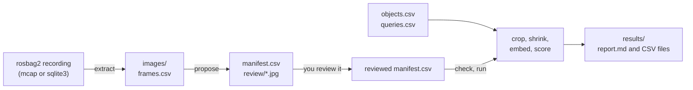

# Embedding bake-off

**Goal:** choose the model that makes walkie-database's object and room
vectors, by testing every candidate on images recorded on the robot.

The bake-off is a command-line tool in `tools/bakeoff/`. It runs in the
default Pixi environment:

```bash
pixi run bakeoff --help
```

It has four subcommands, used in this order:

| Subcommand | What it does                                                                     |
| ---------- | -------------------------------------------------------------------------------- |
| `extract`  | Saves frames from a rosbag2 recording as image files                             |
| `propose`  | Runs YOLOE on the frames and writes the boxes to `manifest.csv` for review       |
| `check`    | Validates the data set files without loading any model                           |
| `run`      | Embeds every crop with every candidate, scores them and writes a report          |

## Background

walkie-database stores one vector per object and per room, and searches them
with text such as "the red mug". Today its tables `object_clip_vit_b16` and
`room_clip_vit_b16` hold CLIP ViT-B/16 vectors. The model choices on the
[Architecture](../architecture/index.md) page propose SigLIP 2 instead, with
EmbeddingGemma 2 as the challenger. The bake-off decides between them with
numbers from the robot's own camera.

The robot sees most objects from a distance, so a crop is often only a few
dozen pixels wide. The bake-off therefore scores every crop at its native
size and again after shrinking it, so that its longest side is 32, 48, 64 or
96 pixels.

### Candidates

| Name in the report | Model                                       | Hugging Face repository, pinned commit                 | Vector | dtype on the GPU                                     | Licence    |
| ------------------ | ------------------------------------------- | ------------------------------------------------------ | -----: | ---------------------------------------------------- | ---------- |
| `clip_vit_b16`     | CLIP ViT-B/16, OpenAI weights (baseline)    | `timm/vit_base_patch16_clip_224.openai` at `977e3dd`   |    512 | float16 autocast                                     | MIT        |
| `siglip2_b16_256`  | SigLIP 2 B/16 at 256 px                     | `google/siglip2-base-patch16-256` at `3f9f96c`         |    768 | float16                                              | Apache-2.0 |
| `eg2_t70`          | EmbeddingGemma 2, at most 70 image tokens   | `google/embeddinggemma-2` at `914f7f8`                 |    768 | bfloat16 if the GPU has it in hardware, else float32 | Apache-2.0 |
| `eg2_t140`         | EmbeddingGemma 2, at most 140 image tokens  | `google/embeddinggemma-2` at `914f7f8`                 |    768 | bfloat16 if the GPU has it in hardware, else float32 | Apache-2.0 |

The full commits are in `src/walkie_vision/models.py`. Each model turns a
query into text with its own template, because each was trained that way:

| Name               | Query text                                                                                  | Image preprocessing                      |
| ------------------ | ------------------------------------------------------------------------------------------- | ---------------------------------------- |
| `clip_vit_b16`     | `a photo of {query}.`                                                                       | Resize to 224 px, then crop the centre   |
| `siglip2_b16_256`  | `this is a photo of {query}.`, in lower case, padded to 64 tokens                           | Resize to 256 x 256                      |
| `eg2_t70`, `eg2_t140` | `task: search result | query: {query}` (the `Retrieval-query` prompt); images have no prompt | Aspect ratio kept, at most 70 or 140 soft tokens |

Details that change the results if they are wrong:

- **CLIP** loads as `ViT-B-16-quickgelu` in open_clip. The OpenAI weights
  were trained with QuickGELU, and the plain `ViT-B-16` gives worse vectors
  with no error.
- **SigLIP 2** uses `pooler_output`, the vector the model was trained to
  compare. Its tokenizer neither lowers the case nor pads by itself, and the
  model was trained on lower-case text padded to 64 tokens, so the tool does
  both.
- **EmbeddingGemma 2** turns an image into soft tokens, one per 3 x 3 patches
  of 16 px. The budget is passed to the image processor on every call. When
  the model loads, the tool checks that the budget took effect and stops if
  it did not. The result is in `run.json` under `budget_check`.
- **EmbeddingGemma 2 never runs in float16.** Gemma models are not made for
  float16. The tool uses bfloat16 only where the GPU supports it in hardware,
  as the RTX 5090 does. On the laptops' RTX 2060 it uses float32, which is
  slower and needs more memory.

### Pipeline



All files of one data set live in one working directory:

| Path            | Written by        | Contents                                                       |
| --------------- | ----------------- | -------------------------------------------------------------- |
| `objects.csv`   | you               | One row per physical object                                    |
| `queries.csv`   | you               | The text queries and the objects that answer each one          |
| `images/`       | `extract`         | The frames, named `<recording>_<message index>.png`            |
| `frames.csv`    | `extract`         | Where each frame came from: recording, topic, index, time stamps |
| `manifest.csv`  | `propose`, then you | One row per box, with the object it shows                    |
| `review/`       | `propose`         | Each frame with its boxes and crop ids drawn on it             |
| `results/`      | `run`             | The report and the raw numbers                                 |

!!! danger "Keep data sets out of git"
    Recordings and frames are large, and they may show people. Keep them
    under `bakeoff-data/`, which the repository's `.gitignore` ignores, or
    outside the repository.

## Step 1: Run the smoke test

The smoke test builds a tiny data set from the two sample images that come
with Ultralytics (`bus.jpg` and `zidane.jpg`) and runs the whole pipeline on
it:

```bash
pixi run bakeoff run --smoke
```

It does this, in `bakeoff-data/smoke/`:

1. Writes an mcap recording with four frames in four raw encodings (`bgra8`,
   `bgr8`, `rgb8` and `rgba8`). The last two are the images mirrored, so
   that every object has two views.
2. Extracts the frames, and writes 11 objects, 12 queries and hand-drawn
   boxes for them. Three queries have two right answers, and two pairs of
   objects look alike (two bollards, two men in dark suits).
3. Runs YOLOE on the frames, in a separate process. Its boxes go to
   `manifest.proposed.csv` and `review/`, for comparison only. The run uses
   the hand-drawn boxes. YOLOE gets its own process because Ultralytics
   sets `CUBLAS_WORKSPACE_CONFIG` when it loads a model, which would make
   every embedder after it slower.
4. Embeds, scores and writes `results/report.md`.

The first run downloads the three models from Hugging Face. After that, add
`--offline`: the run then fails at once if a model is missing, instead of
trying the network. The YOLOE weights come from `pixi run fetch-models`.

!!! info "The smoke numbers mean nothing"
    Eleven objects from two photos cannot rank models. The smoke test shows
    that every model loads, that the pipeline works end to end, and what the
    costs are on this computer. The report says so at the top.

The costs the smoke test measured on an RTX 2060 (2026-10-19, two runs of
`pixi run bakeoff run --smoke --offline`) give a feel for the models. They
are not the robot's numbers:

| Model             | dtype            | ms per crop, batches of 16 | ms per query, batch 1 | Peak MiB |
| ----------------- | ---------------- | -------------------------: | --------------------: | -------: |
| `clip_vit_b16`    | float16 autocast |                          7 |                     7 |      666 |
| `siglip2_b16_256` | float16          |                          4 |                     5 |      818 |
| `eg2_t70`         | float32          |                     78–82 |                 41–42 |    2,201 |
| `eg2_t140`        | float32          |                   178–189 |                 40–42 |    2,731 |

## Step 2: Record on the robot

Record with the robot's own camera, at the robot's own head height, in the
kind of place the robot will search. The bake-off reads one image topic.
Record the camera calibration as well, so that the recording can be used
again later:

| Topic                                        | Type                     | Why                                         |
| -------------------------------------------- | ------------------------ | ------------------------------------------- |
| `/zed_head/zed_node/rgb/color/rect/image`    | `sensor_msgs/Image`, `bgra8`, 2208 x 1242 at 15 Hz | The frames the bake-off uses |
| `/zed_head/zed_node/depth/camera_info`       | `sensor_msgs/CameraInfo` | Calibration, for later use                  |
| `/zed_head/zed_node/depth/depth_registered`  | `sensor_msgs/Image`, `32FC1` | Optional: only if you want depth later  |

```bash title="On the robot"
ros2 bag record -s mcap --storage-preset-profile zstd_fast \
  -o kitchen_day_01 \
  --topics /zed_head/zed_node/rgb/color/rect/image /zed_head/zed_node/depth/camera_info
```

- `-s mcap` writes one `.mcap` file. The tool also reads `sqlite3`
  recordings.
- `--storage-preset-profile zstd_fast` compresses the file as it is written.
  Raw `bgra8` frames are about 11 MB each, so 15 frames a second fill about
  165 MB a second without it. Depth at full size adds as much again.
- Keep each recording short, one or two minutes, and name it after the place
  and the condition, such as `kitchen_day_01`. The name becomes the prefix of
  its frames.

What to record:

| What        | How                                                                                                                         |
| ----------- | --------------------------------------------------------------------------------------------------------------------------- |
| Objects     | About 30 objects of the kinds the robot must find, placed where they would really be: on tables, shelves and the floor.   |
| Distances   | Every object from 1, 2, 3, 4 and 5 m. Far objects give the small crops that the 32 and 48 px buckets stand for.            |
| Views       | Walk or turn slowly, so that each object is seen from several angles. Stop for a second at each distance to avoid blur.   |
| Lighting    | At least two conditions: daylight and room lights only. Add one hard case, such as a window behind the objects.           |
| Similar objects | Several pairs that a person might confuse: two mugs that differ only in colour, two similar bottles, a cup and a glass. Put both objects of a pair in view together, and also apart. |
| People      | Avoid them. If someone must be in view, ask them first.                                                                     |

!!! info "Identical objects"
    Two copies of the same product cannot be told apart by appearance. Record
    one such pair if the robot will meet one, to see it in the report, but do
    not expect any model to separate them. walkie-database tells them apart
    by position.

## Step 3: Write objects.csv and queries.csv

Create the working directory, for example `bakeoff-data/robot/`, and write
two files in it.

```csv title="bakeoff-data/robot/objects.csv"
object_id,label,pair,note
mug_red,mug,mugs,red ceramic mug with a white handle
mug_blue,mug,mugs,same mug in blue
bottle_water,bottle,bottles,clear plastic water bottle
bottle_soda,bottle,bottles,green soda bottle
apple_1,apple,,
```

| Column      | Rules                                                                                                     |
| ----------- | --------------------------------------------------------------------------------------------------------- |
| `object_id` | Letters, digits, `_`, `.` and `-`. Unique. One id per physical object, even if two objects look the same. |
| `label`     | The class name YOLOE is prompted with in step 5, such as `mug`. Required.                                 |
| `pair`      | Optional. Objects with the same `pair` value are compared as similar objects. A group may have more than two. |
| `note`      | Optional. For people only.                                                                                |

```csv title="bakeoff-data/robot/queries.csv"
query,object_ids
the red mug,mug_red
a mug,mug_red mug_blue
something to drink water from,bottle_water mug_red mug_blue
a green bottle,bottle_soda
an apple,apple_1
```

| Column       | Rules                                                                                       |
| ------------ | ------------------------------------------------------------------------------------------- |
| `query`      | What a person would ask the robot to find. Unique. Quote it if it contains a comma.         |
| `object_ids` | Every object that answers the query, separated by spaces. Finding any one of them is a hit. |

Write at least 60 queries, and 100 if you can. With 60 queries, one query
moves R@5 by 0.017, and the decision rule needs a gain of 0.05. Mix three
kinds:

- **Names:** "a mug", "an apple".
- **Attributes:** colour, material, size or state, such as "the red mug" or
  "an empty bottle". These separate the similar pairs.
- **Uses and descriptions:** "something to drink water from", "the thing you
  write with".

Write the queries before you look at any result, and do not change them
afterwards to suit a model.

## Step 4: Extract the frames

```bash
pixi run bakeoff extract ~/bags/kitchen_day_01 --workdir bakeoff-data/robot --every 15
```

- The first argument is the recording directory, or one `.mcap` or `.db3`
  file in it.
- `--every 15` keeps every 15th message, one frame a second from the ZED.
  Consecutive frames are almost the same image, and near-duplicates make the
  results look more certain than they are. Use a larger value for a slow walk.
- `--topic` picks another image topic. Both `sensor_msgs/Image` (`bgra8`,
  `rgba8`, `bgr8`, `rgb8`, `mono8`) and `sensor_msgs/CompressedImage` work.
  If the topic is not in the recording, the error lists the image topics that
  are.
- Raw frames are saved as PNG. Compressed frames are saved as they were
  recorded, without decoding them again.
- Relative paths are resolved from the directory you ran `pixi run` in.

Run `extract` once for each recording, into the same working directory. Each
recording's frames start with its name, and `frames.csv` gets a row for each
frame. Extracting the same recording twice fails, unless you give it another
`--prefix`.

## Step 5: Propose boxes and review them

```bash
pixi run bakeoff propose --workdir bakeoff-data/robot
```

This runs YOLOE-26 in text-prompt mode on every frame, with the labels in
`objects.csv` as prompts. To prompt with other names, write one per line in a
text file and pass `--labels labels.txt`; lines that start with `#` are
skipped. `--conf` sets the lowest score kept (default 0.25).

It writes two things:

- `manifest.csv`: one row per box, with columns `crop_id`, `image`, `x1`,
  `y1`, `x2`, `y2`, `label`, `score` and `object_id`. Coordinates are pixels,
  and `x2` and `y2` are just outside the box.
- `review/<frame>.jpg`: each frame with its boxes and their crop ids drawn on
  it.

`object_id` is filled in only when exactly one object in `objects.csv` has
the box's label. Every other row is left blank. A pre-filled id is a guess:
check it like every other row.

Now review the manifest. Open each overlay in `review/` next to
`manifest.csv` (a spreadsheet works; save it as CSV, UTF-8, with commas), and
give every row an `object_id`:

| `object_id` value | Meaning                                                                       |
| ----------------- | ----------------------------------------------------------------------------- |
| an id from `objects.csv` | Keep the row. The box shows that object.                               |
| `-`               | Drop the row: a wrong box, a duplicate, or something that is not in `objects.csv`. |
| blank             | Not reviewed. `check` and `run` refuse the manifest and list these rows.      |

Rules for a consistent review:

- **Keep a box if a person could tell what the object is from the crop**, and
  at least half of the object is visible. Drop it otherwise.
- **Fix a loose box** by editing its coordinates. A box should be tight around
  the visible part of the object.
- **Add the objects YOLOE missed.** Add a row with a new `crop_id`, the
  frame's file name, the box and the `object_id`. Leave `label` and `score`
  empty. A model that is good at small objects should not lose because the
  detector missed them.
- **Two objects of a pair in one frame** are two rows with two different ids.
  Check them twice: swapping them hides exactly the mistake the separation
  table looks for.

Then check the data set:

```bash
pixi run bakeoff check --workdir bakeoff-data/robot
```

It reads the three files with the same rules as `run`, and prints how many
crops, objects and queries each size bucket has. It fails on a row that is not
reviewed, an unknown id, a bad box, or a query with no crop of any of its
objects. It warns about an object with no crop, a query that is missing some
of its objects, and a pair where neither object has two crops.

The reviewed `manifest.csv` is the record of what a person decided. Keep it
with the results: `run.json` stores its SHA-256, so a later change shows.

## Step 6: Run the bake-off

```bash title="On the robot's computer"
pixi run bakeoff run --workdir bakeoff-data/robot
```

Run it on the robot's computer, or on one with the same GPU. The decision
rule's cost limits are for the robot. On the RTX 2060, EmbeddingGemma 2 runs
in float32 and fails them whatever its recall.

| Option         | Default                    | What it does                                                    |
| -------------- | -------------------------- | --------------------------------------------------------------- |
| `--models`     | all four                   | A comma-separated subset, such as `clip_vit_b16,siglip2_b16_256` |
| `--device`     | `cuda` if there is a GPU   | `cuda`, `cuda:N` or `cpu`                                       |
| `--batch-size` | 16                         | Crops and queries per call                                      |
| `--offline`    | off                        | Never download; fail at once if a model is not cached           |

What happens:

1. Every reviewed box is cut out of its frame. This is the `native` bucket.
2. Each crop is shrunk with area averaging so that its longest side is 32, 48,
   64 and 96 px. A crop is never enlarged: one that is already smaller than a
   size is left out of that bucket. The buckets stand for objects further
   away. Each model then resizes the crop to its own input size, as it would
   on the robot.
3. Every model's files are checked first, so a missing model fails the run
   before any model loads.
4. The models run one at a time. Each one is loaded, warmed up, used for
   every bucket and every query, timed, and freed before the next one loads.
5. The results are scored and written to `results/`.

## Reading the report

`results/report.md` starts with the decision and the reasons for it. The rest
of it, and the CSV files, show where the decision came from.

| File              | One row per                                  |
| ----------------- | -------------------------------------------- |
| `summary.csv`     | model, bucket and level: R@1 and R@5         |
| `per_query.csv`   | model, bucket, level and query: rank, ties, hits, the top candidate and the best target |
| `separation.csv`  | model, bucket and pair of similar objects    |
| `costs.csv`       | model: load time, memory and times per bucket |
| `run.json`        | the run: GPU, driver, package versions, the rule, input hashes, model details |

### Recall levels

A query is ranked against the candidates by cosine similarity. A query is a
**hit at k** if one of its objects is in the top k. **R@k** is the mean over
the queries. There are three ways to rank:

| Level         | A candidate is                                                  | Use                                                               |
| ------------- | --------------------------------------------------------------- | ----------------------------------------------------------------- |
| `object_mean` | One object, with the mean of its crop vectors, scaled back to length 1 | The primary level. walkie-database's object memory stores an object this way. |
| `object_max`  | One object, scored by its best crop                             | What a memory that kept every view could reach.                   |
| `crop`        | One crop. A hit is any crop of a target object.                 | Harsh: five views of one wrong object can fill the top 5.         |

How to read the numbers:

- **Compare models within one column.** A bucket scores only the queries with
  at least one target crop of that size, so two buckets may score different
  queries. The Data table at the bottom gives the counts.
- **Ties count as chance.** Scores closer than 1e-6 are tied. A tied target
  counts as the probability of a hit if the tie were ordered at random, so a
  target tied with one other object for first place counts 0.5 at R@1. No
  random seed is involved, and two runs give the same recall.
- **The best target counts.** For a query with several right answers, the
  highest-ranked one decides the hit.
- **Near-duplicate frames inflate the results.** Many crops of one object from
  one second of video agree with each other, which helps `object_mean` and
  hurts `crop`. Prefer fewer frames from more distances and recordings.

### Similar objects

For every pair from `objects.csv`, each cell shows **margin / nearest-neighbour
accuracy**:

- **within** is the mean cosine between two views of the same object, both
  objects pooled. **between** is the mean cosine between a view of one and a
  view of the other. **margin** is within minus between. Above 0, views of
  one object are closer to each other than to the other object.
- **nearest-neighbour accuracy** is the share of views that are closer to the
  mean of their own object's other views than to the mean of the other
  object's views. A tie counts as half. 0.5 means the model cannot tell them
  apart.

Compare margins only within one model. Each model spreads its cosines
differently, so a margin of 0.05 may be large for one model and small for
another. Nearest-neighbour accuracy can be compared across models.

### Cost

| Column            | Meaning                                                                                          |
| ----------------- | ------------------------------------------------------------------------------------------------ |
| image ms/crop     | Wall time per crop in batches, including preprocessing, mean over 32, 48 and 64 px. The rule reads this. |
| image ms, batch 1 | Median time to embed one 64 px crop on its own, over 32 calls, with the 90th percentile in brackets |
| query ms, batch 1 | Median time to embed one query on its own, over 32 calls, with the 90th percentile in brackets. The rule reads the median. |
| peak MiB          | `torch.cuda.max_memory_allocated` while the model ran. The rule reads this. It leaves out the CUDA context, which `nvidia-smi` adds. |
| weights MiB       | Memory allocated once the model was loaded                                                       |

On the CPU, no memory is measured, and the rule does not pick a challenger.

If the 50 ms query limit lies between a model's median and its 90th
percentile, the result is within timing noise. Run the bake-off again
before you act on it. Both EmbeddingGemma 2 budgets use the same text
model, so their query times differ only by noise.

### Disagreements

The table of queries where the models disagree is the place to look by eye.
Find a query in `per_query.csv`, see which candidate came first (`top`) and
where the target was (`rank`), and open the frames in `review/`. A target
that every model misses often points to a review mistake or a query that a
person would also find unclear.

## The decision rule

The rule was fixed before any recording was made. Its constants are in
`tools/bakeoff/metrics.py` (`Rule`). A test pins them, so a change to them
fails until the test is changed too. Change this page in the same commit.

1. **Score.** Each model's score is its mean `object_mean` R@5 over the 32,
   48 and 64 px buckets. Close objects are easy for every model; far objects
   are where the robot fails to find things. Native and 96 px are reported
   but do not decide.
2. **Sanity check.** If SigLIP 2 scores below CLIP, the verdict is
   `investigate`. SigLIP 2 beats CLIP on public benchmarks, so a loss points
   to the review, the queries or the SigLIP 2 setup before it points to the
   model.
3. **Challengers.** An EmbeddingGemma 2 budget qualifies only if it meets
   every one of these against SigLIP 2:

    | Condition                                                              | Value    |
    | ---------------------------------------------------------------------- | -------- |
    | R@5 gain over SigLIP 2                                                 | ≥ 0.05   |
    | R@1                                                                    | ≥ SigLIP 2's |
    | Queries won minus queries lost at hit@5, over the three buckets        | > 0      |
    | Image time per crop, in batches                                        | ≤ 10 ms  |
    | Query time, batch 1                                                    | ≤ 50 ms  |
    | Peak GPU memory                                                        | ≤ 3,072 MiB |

4. **Verdict.** Among the budgets that qualify, the higher R@5 wins, and a tie
   goes to 70 tokens, the cheaper one. If none qualifies, SigLIP 2 wins. If
   SigLIP 2 was not run, the verdict is `incomplete`.

Why these values:

- **0.05 R@5** is 3 to 5 queries out of 60 to 100: more than a few doubtful
  boxes in the review can move. A switch is not free: it costs a migration
  and new vectors for everything stored, and EmbeddingGemma 2 is slower per
  crop. It needs a clear gain to pay for that.
- **Wins over losses** stops a challenger that gains on average from a few
  queries while losing many others.
- **10 ms per crop** keeps 20 objects in one frame under 0.2 s.
- **50 ms per query** keeps a search fast while the agent waits for the
  answer.
- **3,072 MiB** leaves room for detection, captions, faces and
  re-identification, which share the GPU with the embedder.

!!! danger "Do not tune the rule to the results"
    Change a constant only for a reason that does not come from the results
    it decides, and change it before the run. Otherwise the rule only repeats
    a choice made by looking at the numbers.

## Follow-up: the walkie-database migration

The verdict does not change walkie-database by itself. Its
[ADR-0007](https://eic-robocup-2026.github.io/walkie-database/architecture/database/)
keeps one `vec0` table per model, named `<what>_<model>`. Its migration 0002,
merged in a099e21, adds the rule that `<model>` names the weights, and
renames the face and appearance tables to follow it. `object_clip_vit_b16` and
`room_clip_vit_b16` came before that rule and name only the network, so they
need a migration anyway. Make it one migration, after the bake-off, and use
migration 0002 as the template:

1. **Rename the CLIP tables** so that they name their weights, for example to
   `object_clip_vit_b16_openai` and `room_clip_vit_b16_openai`, or drop them
   if their vectors are not worth keeping. sqlite-vec 0.1 cannot rename a
   `vec0` table, so the migration creates the new table and copies the rows.
2. **Add the winner's tables**, for example
   `object_siglip2_base_patch16_256` and `room_siglip2_base_patch16_256`, with
   768 values and cosine distance. If an EmbeddingGemma 2 budget wins, put
   the budget in the name, such as `object_embeddinggemma_2_t70`, so that
   vectors from two budgets never share a table.
3. **Keep the metadata columns and the triggers.** Every new table needs the
   metadata columns of the table it replaces: `map_id` for rooms, and
   `map_id` and `room_id` for objects. Dropping a table does not drop the
   triggers that write to it, so drop and create again `room_delete`,
   `object_delete` and `object_room_update`, so that they write to the
   renamed tables and the winner's tables. A trigger that still names a
   dropped table makes every delete of a room or an object, and every room
   change of an object, fail. A table that no trigger names keeps the vectors
   of deleted rooms and objects.
4. **Compute new vectors.** A CLIP vector cannot be converted into a SigLIP 2
   or EmbeddingGemma 2 vector. Every stored object and room needs a new
   vector from the new model, or the robot starts with an empty memory.

Then set
[ADR-0008](../architecture/decisions/0008-model-choices.md) to Accepted,
with the measured numbers. The bake-off tests objects only. Room vectors use
the same model, so check room search on the robot as part of the migration.

## Troubleshooting

| Message                                                    | What to do                                                                                    |
| ---------------------------------------------------------- | --------------------------------------------------------------------------------------------- |
| `missing model files: ... not in the Hugging Face cache`   | Run once without `--offline`, with internet access. The message names the cache directory.   |
| `... not in .../models/ultralytics: run pixi run fetch-models` | The YOLOE weights or the MobileCLIP text encoder are missing. Run `pixi run fetch-models`. |
| `N row(s) not reviewed`                                    | Give each listed row an `object_id`, or `-` to drop it.                                      |
| `query ...: none of its objects ... has a crop`            | Add boxes for one of its objects, or remove the query.                                       |
| `the soft-token budget did not take effect`                | sentence-transformers or transformers changed how the budget is passed. Fix that first: the EmbeddingGemma 2 numbers would be for the wrong budget. |
| `no topic ...` from `extract`                              | Use `--topic` with one of the image topics the message lists.                                |
| `... already has N file(s) named <prefix>_<index>`, or `frames.csv already lists ...` | That recording was extracted already. Use another `--prefix` to extract it again, or delete its files and its rows in `frames.csv`. |
| `these images share a name and differ only in the suffix`  | Crop ids and overlays are named after the file name without its suffix. Rename or remove one image of each pair. |
| CUDA out of memory                                         | Use a smaller `--batch-size`. Only one model is loaded at a time.                            |
